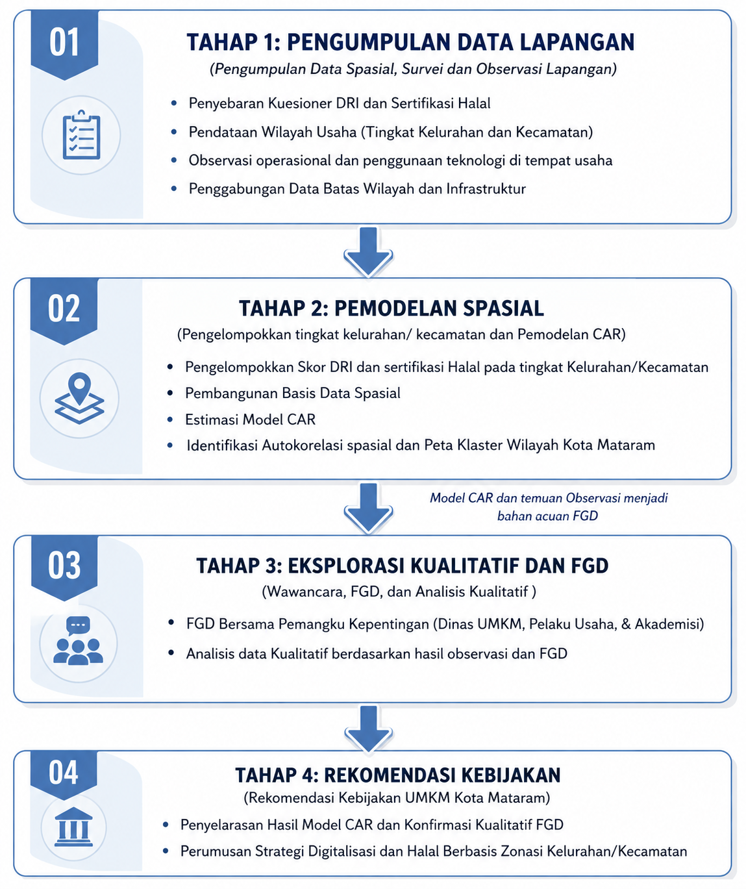
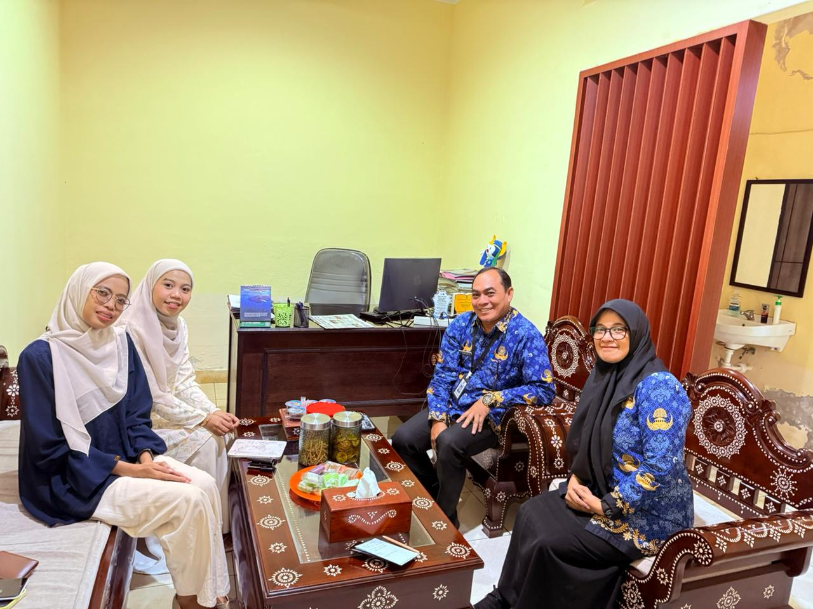
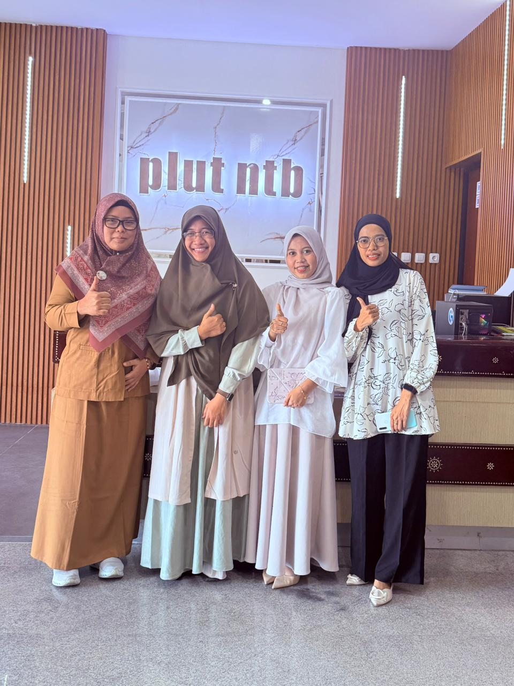

```{r, echo=FALSE, warning=FALSE, message=FALSE}
library(tidyverse)
library(janitor)
library(readxl)
library(gt)
library(ggplot2)
library(dplyr)
```

# Tim Peneliti {.unnumbered .unlisted}


- **Indira Puteri Kinasih, Ph.D.**  
  indiraputeri@uinmataram.ac.id

- **Dr. Any Tsalasatul Fitriyah**  
  any.tsalasatul@uinmataram.ac.id

- **Nurul Susianti, M.E.**  
  nurulsusianti@uinmataram.ac.id

- **Ulfatun Hasanah, M.PA**  
  ulfatunhasanah@uinmataram.ac.id

- **Nur Awalunnisa, M.SEI.**  
  awalunnisa@uinmataram.ac.id

# Abstrak {.unnumbered}

Penelitian ini bertujuan untuk memetakan karakteristik, kesiapan digital, dan kondisi terkait sertifikasi halal Usaha Mikro, Kecil, dan Menengah (UMKM) di Kota Mataram sebagai dasar penyusunan zonasi intervensi kebijakan yang lebih kontekstual. Penelitian menggunakan pendekatan kuantitatif eksploratif dan analisis spasial dengan memanfaatkan data UMKM di Kota Mataram serta survei terhadap pelaku UMKM. Kesiapan digital diukur melalui Digital Readiness Index (DRI) yang dibangun dari beberapa dimensi kemampuan dan praktik digital, sedangkan aspek halal dianalisis melalui indikator kesadaran, kesiapan, hambatan, dukungan, dan akses terhadap sertifikasi halal. Analisis deskriptif digunakan untuk mengidentifikasi karakteristik dan pola kesiapan UMKM, sedangkan analisis spasial berbasis model Conditional Autoregressive (CAR) digunakan untuk mengkaji keterkaitan kesiapan digital dengan pemanfaatan perdagangan elektronik, infrastruktur, hambatan halal, dan kesiapan halal pada tingkat kelurahan.

Hasil penelitian menunjukkan bahwa UMKM di Kota Mataram didominasi oleh usaha mikro dan bentuk usaha perorangan, dengan konsentrasi kegiatan yang kuat pada sektor penyediaan makanan serta perdagangan. Dari 4.185 unit UMKM yang dianalisis dalam basis data administratif, survei lebih lanjut memberikan informasi terperinci mengenai kondisi digital dan halal pelaku usaha. Nilai DRI menunjukkan variasi yang cukup besar antarwilayah. Pada tingkat kelurahan, terdapat pula variasi spasial dalam pemanfaatan e-commerce, infrastruktur digital, serta kesiapan dan hambatan terkait sertifikasi halal. Hasil pemodelan spasial menunjukkan adanya hubungan positif antara DRI dan pemanfaatan e-commerce, sementara pengaruh infrastruktur dan beberapa aspek halal menunjukkan variasi yang lebih besar antarwilayah. Model CAR memberikan kecocokan yang lebih baik dibandingkan model nonspasial, yang menunjukkan pentingnya mempertimbangkan keterkaitan spasial dalam memahami kesiapan UMKM di Kota Mataram.

Temuan tersebut digunakan untuk menyusun zonasi intervensi yang mempertimbangkan kondisi digital dan kesiapan halal secara simultan. Hasil penelitian diwujudkan dalam bentuk peta spasial interaktif, basis informasi karakteristik UMKM, model analisis kesiapan digital, serta rekomendasi kebijakan yang dapat digunakan untuk mengarahkan intervensi berdasarkan karakteristik wilayah. Pendekatan ini diharapkan dapat mendukung pemerintah daerah dan pemangku kepentingan dalam merancang program digitalisasi, pendampingan usaha, dan fasilitasi sertifikasi halal yang lebih terarah dan berbasis bukti.

**Kata kunci:** UMKM, kesiapan digital, *Digital Readiness Index*, sertifikasi halal, analisis spasial, CAR, Kota Mataram.


\newpage

# Pendahuluan

## Latar Belakang

UMKM merupakan bagian penting dalam pembangunan ekonomi yang inklusif dan berkelanjutan. Dalam kerangka *Sustainable Development Goals* (SDGs), penguatan UMKM berkaitan dengan pengentasan kemiskinan (SDG 1), penciptaan pekerjaan dan pertumbuhan ekonomi inklusif (SDG 8), serta inovasi, akses teknologi, dan integrasi usaha kecil ke dalam rantai nilai dan pasar (SDG 9). Arah tersebut sejalan dengan kebijakan pembangunan nasional yang menempatkan UMKM sebagai bagian penting dalam penguatan ekonomi, pemerataan, dan transformasi berbasis teknologi [@bappenas2020rpjmn; @bappenas2025rpjmn]. UMKM juga memiliki keterkaitan erat dengan dunia usaha dan dunia industri (DUDI) sebagai pemasok, produsen, penyedia barang dan jasa, maupun mitra dalam rantai nilai industri, pariwisata, dan ekonomi kreatif [@worldbank2021indonesia].

Indonesia memiliki sekitar 30,18 juta unit UMKM yang terdaftar hingga akhir 2024 [@kadin2024umkm]. Meskipun memiliki peran strategis terhadap ekonomi dan pemerataan pendapatan, sebagian besar UMKM masih menghadapi keterbatasan akses teknologi, pasar, modal, sumber daya manusia, manajemen, dan standardisasi produk [@oecd2018sme; @oecd2021digital; @adb2021asia; @bpsntb2025]. Kondisi tersebut menunjukkan bahwa jumlah UMKM belum dapat menggambarkan kapasitas usaha secara menyeluruh. Pengembangan UMKM karenanya membutuhkan kebijakan yang berbasis data dan mempertimbangkan karakteristik usaha serta wilayah [@worldbank2021indonesia].


| Kabupaten/Kota | Kecil | Menengah | Mikro | **Total** |
|:--|--:|--:|--:|--:|
| Kabupaten Bima | 42 | 22 | 71.032 | **71.096** |
| Kabupaten Dompu | 242 | 10 | 53.452 | **53.704** |
| Kabupaten Lombok Barat | 766 | 6 | 151.400 | **152.172** |
| Kabupaten Lombok Tengah | 86 | 32 | 130.838 | **130.956** |
| Kabupaten Lombok Timur | 13.028 | 620 | 184.004 | **197.652** |
| Kabupaten Lombok Utara | 878 | 246 | 67.368 | **68.492** |
| Kabupaten Sumbawa | 148 | 28 | 41.952 | **42.128** |
| Kabupaten Sumbawa Barat | 996 | 72 | 56.852 | **57.920** |
| Kota Bima | 6.892 | 1.088 | 58.882 | **66.862** |
| **Kota Mataram** | **24.780** | **2.132** | **84.104** | **111.016** |
| **Total** | **47.858** | **4.256** | **899.884** | **951.998** |

: Sebaran UMKM NTB Menurut Klasifikasi Usaha {#tbl-umkm-dist}

Konteks tersebut relevan bagi Kota Mataram sebagai salah satu pusat aktivitas ekonomi Provinsi Nusa Tenggara Barat.
[Data](https://data.ntbprov.go.id/dataset/9d597b1c-8347-4a03-b3e4-e0c224ae425e/show) menunjukkan terdapat **111.016 UMKM** di Kota Mataram, yang didominasi oleh usaha mikro sebanyak **84.104 unit**, diikuti usaha kecil sebanyak **24.780 unit** dan usaha menengah sebanyak **2.132 unit** (@tbl-umkm-dist).
Besarnya jumlah dan dominasi usaha mikro tersebut menunjukkan pentingnya penguatan kapasitas UMKM, namun data agregat belum menjelaskan bagaimana usaha-usaha tersebut tersebar secara geografis dan bagaimana karakteristik wilayah berkaitan dengan konsentrasi UMKM. Oleh karena itu, pemetaan spasial diperlukan untuk memahami distribusi UMKM sekaligus mengidentifikasi kebutuhan intervensi yang lebih tepat sasaran.

Transformasi digital merupakan salah satu aspek penting dalam peningkatan kapasitas UMKM. Penggunaan media sosial, *marketplace*, pembayaran digital, dan teknologi pemasaran dapat memperluas pasar, meningkatkan efisiensi, serta memperkuat keterhubungan UMKM dengan DUDI melalui *e-commerce*, *digital supply chain*, dan *business matching* [@adb2021asia; @chang2021cashless; @morisson2025digitalisasi]. Perkembangan pembayaran digital juga menunjukkan semakin kuatnya integrasi teknologi dalam aktivitas usaha. Namun, tingginya adopsi teknologi pada tingkat nasional tidak berarti bahwa seluruh UMKM memiliki kemampuan dan kesiapan digital yang sama. Perbedaan keterampilan, kapasitas manajerial, infrastruktur, dan akses pendampingan dapat menghasilkan kesenjangan adopsi antarwilayah [@oecd2018sme; @worldbank2021indonesia].

Untuk mengukur kondisi tersebut secara sistematis, penelitian ini menggunakan *Digital Readiness Index* (DRI). Kesiapan digital dipandang sebagai konsep multidimensional yang mencakup aspek teknologi, organisasi, sumber daya manusia, dan proses bisnis [@silva2023clarification]. Dalam penelitian ini, DRI mencakup lima dimensi, yaitu akses teknologi, literasi digital, penggunaan platform digital, kapasitas manajerial digital, dan sikap terhadap teknologi. Pendekatan ini memungkinkan penelitian tidak hanya mengidentifikasi penggunaan teknologi, tetapi juga mengukur tingkat kesiapan dan variasinya antarwilayah. Konsep tersebut sejalan dengan berbagai penelitian mengenai *digital readiness* UMKM [@pirola2019digital; @rafiah2022digital; @anggraini2022assessing; @okfalisa2021measuring].

Selain digitalisasi, sertifikasi halal merupakan aspek penting dalam penguatan kapasitas UMKM, khususnya pada sektor makanan, minuman, dan produk konsumsi. Sertifikasi halal tidak hanya berkaitan dengan kepatuhan terhadap regulasi, tetapi juga dapat meningkatkan kepercayaan konsumen, diferensiasi produk, dan akses pasar [@hartini2024implikasi]. Regulasi melalui UU RI No. 33 Tahun 2014 serta berbagai program fasilitasi pemerintah menunjukkan semakin pentingnya aspek halal dalam pengembangan UMKM [@uu2014jaminan]. Namun, ketersediaan program sertifikasi belum secara otomatis menjamin kepemilikan sertifikat oleh seluruh UMKM. Studi mengenai sertifikasi halal menunjukkan masih adanya kebutuhan pendampingan dan pemetaan kondisi UMKM untuk meningkatkan partisipasi sertifikasi [@nabila2023sertifikasi; @rahayu2023mapping; @purwati2024pendampingan; @fajriana2026analisis].

Digitalisasi dan sertifikasi halal pada akhirnya memiliki dimensi geografis. UMKM yang berdekatan secara spasial dapat memiliki akses yang relatif sama terhadap infrastruktur, pasar, informasi, pendampingan, dan lingkungan ekonomi. Sebaliknya, perbedaan karakteristik wilayah dapat menghasilkan tingkat kesiapan digital dan kepemilikan sertifikasi halal yang berbeda. Oleh karena itu, informasi mengenai lokasi UMKM menjadi penting untuk mengidentifikasi konsentrasi usaha, kesenjangan antarwilayah, serta wilayah yang membutuhkan intervensi berbeda.

Pendekatan geospasial dalam penelitian UMKM sebelumnya telah digunakan untuk mengidentifikasi distribusi dan potensi wilayah [@supriyanto2017klasterisasi], termasuk dalam konteks industri halal dan kualitas produk [@rahayu2023mapping]. Namun, kajian *digital readiness* umumnya lebih berfokus pada faktor internal dan organisasi, sedangkan kajian pemetaan UMKM lebih banyak menekankan distribusi geografis. Di sisi lain, digitalisasi dan sertifikasi halal masih sering dikaji sebagai dua isu yang terpisah. Dengan demikian, masih terdapat keterbatasan dalam mengintegrasikan karakteristik UMKM, kesiapan digital, sertifikasi halal, dan karakteristik wilayah ke dalam suatu kerangka analisis spasial yang dapat diterjemahkan menjadi kebutuhan intervensi kebijakan.

Berdasarkan kesenjangan tersebut, penelitian ini mengembangkan model zonasi intervensi kebijakan UMKM berbasis geospasial dengan mengintegrasikan tiga kelompok informasi utama: karakteristik dan lokasi UMKM, tingkat kesiapan/adopsi digital, serta status sertifikasi halal. Data UMKM dipetakan berdasarkan lokasi dan karakteristik usaha, sedangkan survei digunakan untuk memperoleh informasi mengenai kesiapan digital dan sertifikasi halal. Selanjutnya, analisis spasial digunakan untuk mengidentifikasi pola distribusi, pengelompokan, dan kesenjangan antarwilayah. Analisis yang direncanakan mencakup pemetaan, Moran’s I, LISA, dan pemodelan spasial berbasis CAR.

Hasil analisis selanjutnya digunakan untuk membentuk zonasi berdasarkan kebutuhan intervensi. Wilayah dengan kebutuhan penguatan digital dapat dikategorikan sebagai zona prioritas digitalisasi, wilayah dengan kebutuhan peningkatan sertifikasi sebagai zona prioritas sertifikasi halal, sedangkan wilayah yang menghadapi kedua persoalan tersebut dapat diarahkan pada intervensi terpadu. Dengan demikian, kebijakan tidak hanya didasarkan pada jumlah UMKM, tetapi juga mempertimbangkan lokasi, karakteristik usaha, kesiapan digital, status halal, dan kebutuhan spesifik wilayah.

Kebaruan penelitian ini terletak pada integrasi informasi spasial UMKM, kesiapan digital, dan sertifikasi halal untuk menghasilkan zonasi kebutuhan intervensi kebijakan yang terdiferensiasi. Kontribusi penelitian bukan sekadar menghasilkan peta distribusi UMKM, tetapi menyediakan informasi berbasis bukti (*evidence-based*) yang dapat membantu pemerintah menentukan wilayah prioritas dan jenis intervensi secara lebih tepat. Kerangka tersebut juga berpotensi direplikasi pada wilayah lain dengan menyesuaikan indikator, data, dan karakteristik lokal. Dengan demikian, penelitian diharapkan mendukung penguatan kapasitas UMKM, percepatan adopsi teknologi, peningkatan akses terhadap standar halal, pengurangan kesenjangan antarwilayah, dan pengembangan kebijakan UMKM yang lebih tepat sasaran.


## Rumusan Masalah

Berdasarkan uraian latar belakang, rumusan masalah dalam penelitian ini adalah:

1. Bagaimana pola sebaran UMKM di Kota Mataram berdasarkan lokasi geografis, jenis usaha, skala usaha, dan karakteristik wilayah?

2. Bagaimana tingkat kesiapan dan adopsi digital UMKM di Kota Mataram, ditinjau dari penggunaan media sosial, *marketplace*, pembayaran digital, dan teknologi pemasaran digital, serta bagaimana kesenjangan digital antarwilayah?

3. Bagaimana status kepemilikan dan tingkat kesiapan sertifikasi halal UMKM, khususnya pada sektor makanan, minuman, dan produk konsumsi, serta apa saja hambatan yang dihadapi dalam proses sertifikasi?

4. Bagaimana klasifikasi wilayah UMKM berdasarkan kebutuhan intervensi, khususnya untuk menentukan zona prioritas digitalisasi dan zona prioritas sertifikasi halal?

5. Bagaimana merumuskan rekomendasi kebijakan pengembangan UMKM berbasis geospasial yang dapat mendukung penentuan prioritas intervensi dan berpotensi direplikasi pada daerah lain dengan karakteristik serupa?

## Tujuan Penelitian

Tujuan penelitian ini adalah:

1. Mengidentifikasi dan memetakan pola sebaran UMKM di Kota Mataram berdasarkan lokasi geografis, jenis usaha, skala usaha, dan karakteristik wilayah menggunakan pendekatan geospasial.

2. Menganalisis tingkat kesiapan dan adopsi digital UMKM di Kota Mataram, yang meliputi penggunaan media sosial, marketplace, pembayaran digital, dan teknologi pemasaran digital, serta mengidentifikasi kesenjangan digital antarwilayah.

3. Menganalisis status kepemilikan dan tingkat kesiapan sertifikasi halal UMKM, khususnya pada sektor makanan, minuman, dan produk konsumsi, serta mengidentifikasi hambatan yang dihadapi pelaku UMKM dalam proses sertifikasi.

4. Menyusun zonasi UMKM berdasarkan kebutuhan intervensi kebijakan, dengan mengidentifikasi wilayah prioritas digitalisasi dan wilayah prioritas sertifikasi halal.

5. Merumuskan rekomendasi kebijakan pengembangan UMKM berbasis geospasial untuk mendukung penentuan prioritas intervensi yang dapat diadaptasi atau direplikasi pada daerah lain dengan karakteristik serupa.

## Manfaat Penelitian

Penelitian ini diharapkan memberikan manfaat ilmiah dan praktis melalui integrasi pendekatan geospasial, kesiapan digital, dan sertifikasi halal dalam menghasilkan informasi serta rekomendasi kebijakan UMKM berbasis wilayah.

### Manfaat Ilmiah

Penelitian ini berkontribusi pada pengembangan kajian UMKM dengan mengintegrasikan dimensi spasial, kesiapan dan adopsi digital, serta sertifikasi halal dalam satu kerangka analisis. Pendekatan ini memberikan perspektif yang lebih komprehensif dalam memahami variasi kondisi UMKM antarwilayah dan kebutuhan intervensinya.

Secara metodologis, penelitian ini menunjukkan pemanfaatan analisis geospasial untuk memetakan distribusi UMKM, mengidentifikasi kesenjangan digital dan sertifikasi halal, serta menyusun zonasi prioritas intervensi. Kerangka tersebut dapat menjadi referensi bagi penelitian selanjutnya mengenai transformasi digital, ekonomi halal, pengembangan UMKM, dan kebijakan pembangunan berbasis wilayah.

### Manfaat Praktis

Penelitian ini menghasilkan basis informasi spasial mengenai karakteristik UMKM, kesiapan dan adopsi digital, serta status sertifikasi halal yang dapat dimanfaatkan oleh pemerintah dan pemangku kepentingan dalam merancang program yang lebih tepat sasaran.

Secara khusus, hasil penelitian dapat digunakan untuk:

1. menentukan wilayah dan kelompok UMKM yang menjadi prioritas untuk program digitalisasi dan sertifikasi halal;

2. merancang bentuk pendampingan yang sesuai dengan kebutuhan wilayah, seperti literasi digital, pemanfaatan marketplace, pembayaran digital, pemasaran digital, dan fasilitasi sertifikasi halal;

3. memperkuat keterhubungan UMKM dengan DUDI melalui perluasan pasar, business matching, kemitraan, dan integrasi ke dalam rantai pasok; serta

4. memberikan informasi bagi pelaku UMKM mengenai kondisi, peluang, dan kebutuhan pengembangan usaha di wilayahnya.

### Manfaat bagi Pembangunan Daerah

Pada tingkat pembangunan daerah, penelitian ini menyediakan evidence base untuk perencanaan intervensi UMKM yang lebih terarah, inklusif, dan berbasis karakteristik wilayah. Pemetaan spasial memungkinkan sumber daya dan program pemerintah diarahkan pada wilayah yang memiliki kebutuhan paling besar, sehingga tidak semata-mata didasarkan pada jumlah UMKM atau batas administratif.

Hasil penelitian juga dapat mendukung transformasi ekonomi digital, penguatan ekosistem ekonomi halal, serta pengembangan UMKM yang terhubung dengan sektor pariwisata dan ekonomi kreatif. Lebih lanjut, kerangka zonasi dan rekomendasi yang dihasilkan dapat menjadi model yang diadaptasi pada daerah lain dengan karakteristik sosial-ekonomi dan geografis yang serupa.

<!-- Usaha Mikro, Kecil, dan Menengah (UMKM) merupakan pilar utama perekonomian Indonesia yang berperan penting dalam menciptakan lapangan kerja, meningkatkan pendapatan masyarakat, serta mendukung pertumbuhan ekonomi yang inklusif. Dalam mendukung pencapaian Sustainable Development Goals (SDGs) dan agenda pembangunan nasional, penguatan daya saing UMKM menjadi salah satu prioritas pemerintah melalui percepatan transformasi digital dan peningkatan kepemilikan sertifikasi halal. Namun demikian, tingkat adopsi teknologi digital maupun kepemilikan sertifikasi halal di kalangan UMKM masih belum merata antarwilayah sehingga memerlukan kebijakan yang lebih terarah dan berbasis bukti. -->

<!-- Kota Mataram sebagai pusat pemerintahan Provinsi Nusa Tenggara Barat memiliki jumlah UMKM yang besar dengan dominasi pada sektor kuliner, fesyen, dan kerajinan yang berpotensi mendukung pengembangan pariwisata halal. Meskipun demikian, hingga saat ini belum tersedia informasi yang komprehensif mengenai tingkat kesiapan digital UMKM, status kepemilikan sertifikasi halal, maupun pola persebarannya secara spasial. Kondisi tersebut menyebabkan penyusunan program pembinaan dan intervensi kebijakan masih cenderung bersifat umum dan belum mempertimbangkan karakteristik wilayah secara spesifik. -->

<!-- Penelitian ini bertujuan menyusun zonasi intervensi kebijakan UMKM berbasis pemetaan geospasial guna mendukung percepatan digitalisasi dan sertifikasi halal di Kota Mataram. Penelitian mengintegrasikan pengukuran **Digital Readiness Index (DRI)**, analisis spasial, serta pemodelan statistik spasial untuk mengidentifikasi wilayah prioritas yang memerlukan intervensi kebijakan. Hasil penelitian diharapkan menjadi dasar penyusunan rekomendasi kebijakan yang lebih efektif, efisien, dan tepat sasaran dalam mendukung pengembangan UMKM berbasis wilayah. -->

<!-- Hingga periode pelaporan kemajuan ini, kegiatan penelitian telah memasuki tahap persiapan pelaksanaan survei lapangan. Kegiatan yang telah dilaksanakan meliputi studi literatur, penyusunan instrumen penelitian, koordinasi dengan pemerintah daerah dan pemangku kepentingan terkait, serta inventarisasi data pendahuluan sebagai dasar pembangunan basis data spasial UMKM. Tahapan berikutnya difokuskan pada pelaksanaan *pilot testing* instrumen, survei utama, pembangunan basis data geospasial, dan analisis Digital Readiness UMKM menggunakan pendekatan Bayesian **Conditional Autoregressive (CAR)**. -->


## Ringkasan Kemajuan

| Kegiatan | Status |
|:------------------------------|:-------:|
| Studi literatur | selesai |
| Penyusunan instrumen | selesai |
| Koordinasi awal dengan *stakeholder* | selesai |
| Pengumpulan data pendahuluan | selesai |
| Uji coba instrumen | Proses |
| Survei utama | Proses |
| Analisis spasial | Belum |

Persentase capaian penelitian diperkirakan mencapai **40%**.


# Kajian Teori

## Kajian Penelitian Terdahulu

Penelitian mengenai *digital readiness* pada usaha mikro, kecil, dan menengah (UMKM) menunjukkan bahwa kesiapan digital merupakan konsep multidimensional yang mencakup aspek teknologi, organisasi, sumber daya manusia, dan proses bisnis. @silva2023clarification melakukan kajian konseptual dan sistematis terhadap berbagai pendekatan dalam menilai kesiapan digital organisasi, khususnya pada UMKM. Sejalan dengan hal tersebut, @okfalisa2021measuring mengembangkan model penilaian kesiapan digital UMKM berbasis *multiple perspectives decision support system* yang mengintegrasikan faktor teknologi, organisasi, lingkungan, dan sumber daya manusia. Temuan tersebut menunjukkan bahwa faktor internal UMKM memiliki peran penting dalam menentukan keberhasilan digitalisasi, terutama dalam konteks negara berkembang.

Penelitian @anggraini2022assessing juga membahas penilaian kesiapan digital UMKM melalui *intelligent dashboard decision support system*, sedangkan @rafiah2022digital mengkaji kesiapan digital UMKM dalam konteks Indonesia. Sementara itu, @pirola2019digital menunjukkan bahwa instrumen *digital readiness* yang dikembangkan untuk perusahaan besar belum tentu sesuai untuk UMKM karena cenderung menekankan tingkat kecanggihan teknologi yang telah digunakan, bukan kesiapan organisasi dalam melakukan transformasi. Oleh karena itu, pengukuran kesiapan digital pada UMKM perlu mempertimbangkan karakteristik usaha, keterbatasan sumber daya, serta kemampuan organisasi dalam mengadopsi perubahan.

Dalam konteks spasial, @supriyanto2017klasterisasi mengkaji klasifikasi dan pemetaan UMKM serta potensi wilayah sebagai strategi pengembangan ekonomi daerah. Hasil penelitian menunjukkan bahwa pemetaan dan klasterisasi UMKM berdasarkan karakteristik wilayah dapat membantu pemerintah dalam menentukan prioritas pembangunan ekonomi. Pendekatan spasial pada sektor halal dilakukan oleh @rahayu2023mapping melalui pemetaan industri pangan halal, aman, dan berkualitas bagi usaha mikro dan kecil di Kabupaten Pasuruan. Penelitian tersebut menunjukkan bahwa pemetaan dapat digunakan untuk mengidentifikasi sebaran UMKM pangan halal dan potensi peningkatan kualitas produk.

Meskipun demikian, penelitian terdahulu umumnya mengkaji digitalisasi, karakteristik spasial, atau aspek halal secara terpisah. Belum banyak pendekatan yang mengintegrasikan **sebaran UMKM, kesiapan digital, kesiapan sertifikasi halal, serta kebutuhan intervensi kebijakan dalam satu kerangka spasial**. Selain itu, sebagian penelitian empiris mengenai digitalisasi UMKM masih menggunakan pendekatan regresi klasik yang mengasumsikan bahwa setiap unit usaha bersifat independen secara spasial, meskipun terdapat indikasi bahwa karakteristik wilayah dapat memengaruhi aktivitas dan perkembangan UMKM.

Asumsi independensi tersebut menjadi kurang sesuai ketika UMKM beroperasi dalam ruang geografis yang berdekatan dan memiliki keterkaitan melalui klaster usaha, destinasi wisata, jaringan pasar, maupun kawasan ekonomi lokal. Oleh karena itu, pendekatan spasial menjadi relevan untuk menganalisis fenomena ekonomi yang memiliki struktur geografis (*spatially structured*). Kebutuhan untuk mempertimbangkan ketergantungan spasial juga ditemukan dalam penelitian mengenai harga rumah, di mana nilai properti tidak hanya dipengaruhi oleh karakteristik internal, tetapi juga oleh kondisi lingkungan dan properti di sekitarnya (@kinasih2025conditionally).

Berdasarkan penelitian terdahulu tersebut, penelitian ini menempatkan dimensi geografis sebagai bagian penting dalam memahami variasi kondisi UMKM. Integrasi antara pemetaan spasial, pengukuran kesiapan digital, kesiapan sertifikasi halal, dan analisis kebutuhan intervensi diharapkan dapat menghasilkan pendekatan kebijakan UMKM yang lebih tepat sasaran dan berbasis wilayah.

## UMKM

Usaha Mikro, Kecil, dan Menengah (UMKM) merupakan bagian penting dari struktur perekonomian Indonesia. Menurut Undang-Undang Nomor 20 Tahun 2008 tentang Usaha Mikro, Kecil, dan Menengah, UMKM merupakan usaha produktif yang berdiri sendiri dan memenuhi kriteria tertentu berdasarkan kekayaan bersih atau hasil penjualan tahunan.

Berdasarkan ketentuan tersebut, UMKM diklasifikasikan menjadi usaha mikro, usaha kecil, dan usaha menengah. Usaha mikro memiliki kekayaan bersih paling banyak Rp50.000.000,00, tidak termasuk tanah dan bangunan tempat usaha, atau hasil penjualan tahunan paling banyak Rp300.000.000,00. Usaha kecil memiliki kekayaan bersih lebih dari Rp50.000.000,00 sampai dengan paling banyak Rp500.000.000,00, atau hasil penjualan tahunan lebih dari Rp300.000.000,00 sampai dengan paling banyak Rp2.500.000.000,00. Sementara itu, usaha menengah memiliki kekayaan bersih lebih dari Rp500.000.000,00 sampai dengan paling banyak Rp10.000.000.000,00, atau hasil penjualan tahunan lebih dari Rp2.500.000.000,00 sampai dengan paling banyak Rp50.000.000.000,00.

Dalam penelitian ini, UMKM dipahami tidak hanya sebagai unit ekonomi, tetapi juga sebagai unit usaha yang memiliki lokasi geografis tertentu. Dengan demikian, karakteristik UMKM dapat dianalisis tidak hanya berdasarkan skala dan jenis usaha, tetapi juga berdasarkan pola distribusi dan karakteristik wilayah tempat usaha tersebut beroperasi.

## Literasi Digital dan Adopsi Teknologi

Literasi digital merupakan salah satu aspek penting dalam kemampuan individu maupun organisasi untuk memanfaatkan teknologi digital secara efektif. @unesco2004plurality memandang literasi dalam konteks yang lebih luas daripada sekadar kemampuan membaca dan menulis, yaitu mencakup kemampuan untuk mendefinisikan, memahami, menafsirkan, menciptakan, mengomunikasikan, memperhitungkan, dan menggunakan informasi dalam berbagai konteks.

Lankshear dan Knobel (2011), sebagaimana dibahas dalam @rizal2022literasi, memaknai literasi digital sebagai kemampuan membaca dan menulis dalam konteks pemanfaatan teknologi digital. Konsep tersebut kemudian berkembang menjadi kemampuan yang lebih luas, tidak hanya menggunakan perangkat komputer untuk membaca dan menulis, tetapi juga mencakup produksi dan pemanfaatan media digital, pemrosesan informasi, partisipasi dalam jejaring sosial, berbagi pengetahuan, serta keterampilan komputasi profesional (@tour2015digital).

Dalam konteks UMKM, literasi digital menjadi dasar bagi kemampuan pelaku usaha dalam mengadopsi teknologi untuk mendukung kegiatan bisnis. Pemanfaatan teknologi digital dapat mencakup komunikasi dengan pelanggan, pemasaran, transaksi, pembayaran, pengelolaan informasi, hingga pengambilan keputusan.

Sistem informasi digital juga tidak terbatas pada penggunaan komputer, tetapi mencakup serangkaian prosedur untuk mengumpulkan, mengelompokkan, mengolah, dan mendistribusikan data menjadi informasi yang dibutuhkan pengguna. Dalam konteks sistem informasi, beberapa bentuk sistem yang umum digunakan meliputi *Transaction Processing System* (TPS), *Management Information System* (MIS), *Office Automation System* (OAS), *Decision Support System* (DSS), *Executive Information System* (EIS), dan *Intelligent Support System* (ISS) (@rozaq2020konsep).

Salah satu pendekatan yang banyak digunakan untuk menjelaskan penerimaan teknologi adalah *Technology Acceptance Model* (TAM). Model ini menekankan persepsi pengguna terhadap kemudahan dan manfaat penggunaan teknologi. Beberapa indikator yang dapat digunakan antara lain kemudahan untuk dipelajari, kemudahan untuk dioperasikan, kejelasan dan kemudahan pemahaman, serta kemudahan untuk menjadi terampil dalam menggunakan teknologi (@wicaksono2022tam).

Dalam penelitian ini, literasi dan adopsi teknologi digital dipandang sebagai bagian dari proses kesiapan UMKM dalam melakukan transformasi digital. Dengan demikian, pengukuran tidak hanya mempertimbangkan apakah UMKM telah menggunakan teknologi tertentu, tetapi juga sejauh mana teknologi tersebut telah terintegrasi dalam aktivitas usaha.

## *Digital Readiness Index* (DRI)

Transformasi digital pada sektor UMKM membutuhkan instrumen yang dapat mengukur tingkat kesiapan usaha dalam mengadopsi dan mengintegrasikan teknologi digital. @pirola2019digital menunjukkan bahwa instrumen *digital readiness* yang dikembangkan untuk perusahaan besar cenderung terlalu berorientasi pada kecanggihan teknologi yang telah digunakan dan kurang memperhatikan kesiapan organisasi dalam melakukan perubahan. Bagi UMKM yang memiliki keterbatasan modal dan sumber daya, pengukuran kesiapan awal menjadi penting agar investasi dan intervensi teknologi dapat dilakukan secara lebih efektif.

Dalam merumuskan indikator kesiapan digital yang sesuai dengan karakteristik UMKM di negara berkembang, perspektif ekonomi dan teknologi informasi perlu diintegrasikan secara proporsional (@okfalisa2021measuring). @silva2023clarification mengidentifikasi sejumlah dimensi kesiapan digital yang mencakup aspek bisnis, pasar, strategi, organisasi, dan proses. Pendekatan tersebut sejalan dengan *Digital Readiness Level 4.0* yang dikembangkan oleh @pirola2019digital, yang menekankan bahwa penerapan teknologi perlu disesuaikan dengan struktur dan karakteristik organisasi UMKM.

@okfalisa2021measuring juga menunjukkan bahwa kesiapan melakukan transaksi digital merupakan salah satu aspek penting bagi UMKM di negara berkembang, diikuti oleh aspek strategi pemasaran, lingkungan, dan manajemen. Temuan tersebut menunjukkan bahwa kesiapan digital UMKM tidak semata-mata berkaitan dengan kepemilikan teknologi canggih, tetapi juga mencakup kemampuan membangun praktik kerja digital, meningkatkan keterampilan, menyediakan akses internet yang memadai, serta menjaga kapasitas organisasi dan finansial untuk mendukung transformasi digital.

Berdasarkan kerangka tersebut, penelitian ini mengoperasionalkan *Digital Readiness Index* (DRI) ke dalam tujuh dimensi utama, yaitu:

1. infrastruktur digital;
2. keterampilan digital;
3. proses bisnis;
4. strategi digital;
5. keamanan digital;
6. data dan inovasi; serta
7. *e-commerce* dan media sosial.

Ketujuh dimensi tersebut selanjutnya diturunkan ke dalam indikator-indikator kuesioner untuk memperoleh ukuran kuantitatif mengenai tingkat kesiapan digital masing-masing UMKM. DRI kemudian digunakan untuk mengidentifikasi variasi kesiapan digital antarwilayah dan menjadi salah satu dasar dalam penyusunan zonasi kebutuhan intervensi.

## Sertifikasi Halal

Sertifikasi halal merupakan salah satu aspek penting dalam pengembangan UMKM, khususnya pada sektor makanan, minuman, dan produk konsumsi. @uu2014jaminan mendefinisikan produk sebagai barang dan/atau jasa yang berkaitan dengan makanan, minuman, obat, kosmetik, produk kimiawi, produk biologi, produk rekayasa genetik, serta barang gunaan yang dipakai, digunakan, atau dimanfaatkan oleh masyarakat.

Undang-Undang Nomor 33 Tahun 2014 juga menjelaskan bahwa Proses Produk Halal (PPH) merupakan rangkaian kegiatan untuk menjamin kehalalan produk, yang mencakup penyediaan bahan, pengolahan, penyimpanan, pengemasan, pendistribusian, penjualan, dan penyajian produk. Sertifikat halal merupakan bentuk pengakuan kehalalan suatu produk yang diterbitkan oleh Badan Penyelenggara Jaminan Produk Halal (BPJPH) berdasarkan ketentuan yang berlaku (@uu2014jaminan).

Dalam proses sertifikasi halal, pelaku usaha memiliki sejumlah kewajiban, antara lain memberikan informasi secara benar, jelas, dan jujur; memisahkan lokasi, tempat, dan alat yang digunakan untuk proses produk halal dari produk yang tidak halal; memiliki penyelia halal; serta melaporkan perubahan komposisi kepada BPJPH.

Selain aspek regulasi, kesiapan UMKM dalam memenuhi persyaratan halal juga dipengaruhi oleh pemahaman dan kapasitas pelaku usaha. @kurniawati2020awareness mengembangkan indikator yang berkaitan dengan tingkat kesadaran konsumen terhadap produk halal. Dalam konteks UMKM, aspek pemahaman mengenai pentingnya label halal, persepsi terhadap kepercayaan konsumen, pengetahuan mengenai proses teknis, kesiapan administratif, dan kebutuhan pendampingan menjadi bagian penting dalam memahami kesiapan sertifikasi halal (@nabila2023sertifikasi).

Berbagai hambatan juga dapat memengaruhi kemampuan UMKM dalam memperoleh sertifikasi halal. Hambatan tersebut antara lain keterbatasan biaya, akses terhadap pusat layanan, serta efektivitas sosialisasi dan pendampingan pemerintah. Faktor-faktor tersebut penting untuk diperhatikan karena sertifikasi halal tidak hanya berkaitan dengan kepatuhan regulasi, tetapi juga berpotensi meningkatkan daya saing dan memperluas pangsa pasar UMKM (@fajriana2026analisis).

Dalam penelitian ini, status sertifikasi halal dan kesiapan UMKM dalam memenuhi persyaratan halal dianalisis sebagai salah satu dimensi kebutuhan intervensi. Informasi tersebut selanjutnya dipadukan dengan informasi spasial dan DRI untuk mengidentifikasi wilayah yang membutuhkan prioritas fasilitasi sertifikasi halal.

## Model Regresi Spasial

Aktivitas UMKM memiliki keterkaitan dengan lingkungan geografis tempat usaha beroperasi. UMKM yang berada dalam wilayah yang berdekatan dapat memiliki akses terhadap infrastruktur, pasar, jaringan usaha, konsumen, maupun program pemerintah yang relatif serupa. Kondisi tersebut memungkinkan munculnya ketergantungan spasial, sehingga asumsi bahwa setiap unit usaha bersifat independen tidak selalu dapat dipertahankan.

Regresi spasial digunakan untuk mengakomodasi ketergantungan antarunit observasi yang memiliki hubungan geografis. Dalam pendekatan Bayesian, *Conditional Autoregressive* (CAR) dapat digunakan sebagai komponen spasial dalam model hierarkis untuk menangkap variasi yang terstruktur secara geografis. Pendekatan ini juga digunakan dalam analisis data harga rumah, ketika karakteristik suatu properti dipengaruhi oleh karakteristik properti dan lingkungan di sekitarnya (@kinasih2025conditionally).

Secara umum, model regresi dengan efek spasial dapat dituliskan sebagai:

$$
y_i = \mathbf{x}_i^T\boldsymbol{\beta} + u_i + \epsilon_i,
\tag{1}
$$

dengan $y_i$ merupakan variabel respons, $\mathbf{x}_i$ merupakan vektor kovariat, $\boldsymbol{\beta}$ merupakan vektor parameter regresi, $u_i$ merupakan efek spasial, dan $\epsilon_i$ merupakan komponen galat.

Dalam model CAR, efek spasial diberikan struktur prior yang bergantung pada hubungan ketetanggaan antarwilayah. Salah satu bentuk umum prior CAR dapat dituliskan sebagai:

$$
\mathbf{u} \sim N\left(\mathbf{0},
\left[\tau(\mathbf{D}-\rho\mathbf{W})\right]^{-1}\right),
\tag{2}
$$

dengan $\mathbf{W}$ merupakan matriks bobot spasial, $\mathbf{D}$ merupakan matriks diagonal yang berisi jumlah tetangga setiap wilayah, $\rho$ merepresentasikan kekuatan ketergantungan spasial, dan $\tau$ merupakan parameter presisi.

Struktur CAR memungkinkan informasi dari wilayah yang berdekatan digunakan dalam proses estimasi sehingga pola pengelompokan dan variasi spasial yang tidak teramati dapat dimodelkan secara eksplisit. Pendekatan ini relevan untuk fenomena sosial-ekonomi yang memiliki struktur geografis, termasuk distribusi dan karakteristik UMKM.

Dalam penelitian ini, pendekatan spasial digunakan untuk mengidentifikasi variasi antarwilayah serta mendukung penyusunan zonasi kebutuhan intervensi. Dengan demikian, informasi spasial tidak hanya digunakan untuk visualisasi sebaran UMKM, tetapi juga menjadi bagian dari analisis dalam menentukan wilayah yang memiliki kebutuhan intervensi yang berbeda.

## *Policy Design*

*Policy design* merupakan pendekatan dalam studi kebijakan publik yang berfokus pada perancangan kebijakan dengan menghubungkan permasalahan publik, tujuan yang hendak dicapai, kelompok sasaran, instrumen kebijakan, dan konteks implementasinya (@howlett2019designing).

Salah satu pendekatan yang relevan adalah *evidence-informed policy making*, yaitu proses penggunaan berbagai sumber informasi, termasuk data statistik, hasil penelitian, dan evaluasi, sebagai dasar dalam merancang, melaksanakan, atau mengubah kebijakan dan program publik (@oecd2020mobilising). Penggunaan bukti penting untuk memahami permasalahan, mengidentifikasi kebutuhan, membandingkan alternatif intervensi, dan meningkatkan kualitas desain kebijakan.

Dalam penelitian ini, *policy design* digunakan sebagai landasan untuk menerjemahkan bukti empiris dan spasial ke dalam desain intervensi kebijakan. Informasi mengenai persebaran dan karakteristik UMKM, tingkat kesiapan digital, serta status dan kesiapan sertifikasi halal digunakan untuk mengidentifikasi perbedaan kebutuhan antarwilayah. Perbedaan kebutuhan tersebut kemudian menjadi dasar dalam penyusunan zona prioritas intervensi.

Berdasarkan kerangka tersebut, penelitian ini mengembangkan **Model Intervensi Kebijakan UMKM Berbasis Geospasial dan Kebutuhan** (*Geospatial-Based Needs-Targeted MSME Policy Model*). Model ini mengintegrasikan informasi spasial dengan tingkat kesiapan digital dan kesiapan sertifikasi halal UMKM melalui tahapan:

1. *spatial mapping*;
2. *assessment of digital readiness*;
3. *assessment of halal certification readiness*;
4. *spatial gap analysis*;
5. *needs-based zoning*;
6. *targeted policy intervention*; dan
7. *monitoring and evaluation*.

Model tersebut menjadi dasar dalam merumuskan rekomendasi kebijakan yang lebih spesifik dan operasional. Hasil *policy design* selanjutnya dikomunikasikan melalui *policy brief* sebagai media untuk menerjemahkan temuan penelitian dan model intervensi ke dalam rekomendasi yang ringkas, berbasis bukti, dan dapat digunakan oleh pengambil keputusan.

# Metode

Penelitian ini dirancang untuk mengkaji kesiapan digital UMKM di Kota Mataram dalam konteks penguatan ekosistem pariwisata halal dengan mengintegrasikan survei, pemetaan spasial, pemodelan statistik spasial, serta eksplorasi kualitatif. Integrasi tersebut memungkinkan penelitian tidak hanya mengidentifikasi tingkat kesiapan digital UMKM, tetapi juga memahami pola geografis, faktor yang berkaitan dengan variasi kesiapan digital, serta kebutuhan intervensi kebijakan berbasis wilayah.

## Jenis Penelitian

Penelitian ini merupakan penelitian terapan dengan pendekatan *mixed methods* yang mengintegrasikan analisis kuantitatif dan kualitatif. Pendekatan kuantitatif digunakan untuk memetakan sebaran UMKM, mengukur tingkat kesiapan digital, mengidentifikasi pola geografis kesiapan digital, serta menganalisis faktor-faktor yang berkaitan dengan variasi kesiapan tersebut dengan mempertimbangkan ketergantungan spasial antarwilayah.

Sementara itu, pendekatan kualitatif digunakan untuk memberikan konteks terhadap temuan kuantitatif melalui observasi, wawancara, dan *Focus Group Discussion* (FGD). Integrasi kedua pendekatan tersebut memungkinkan penelitian tidak hanya menjawab pertanyaan mengenai **seberapa siap UMKM secara digital**, tetapi juga **di mana kesenjangan kesiapan tersebut terjadi, faktor apa yang melatarbelakanginya, dan bentuk intervensi apa yang sesuai dengan karakteristik masing-masing wilayah**.

Hasil penelitian selanjutnya digunakan sebagai dasar penyusunan rekomendasi kebijakan UMKM berbasis wilayah di Kota Mataram.

## Desain Penelitian

Desain penelitian menggunakan pendekatan *sequential mixed methods*. Tahap pertama dilakukan melalui pengumpulan dan analisis data kuantitatif berupa survei *Digital Readiness*, pemetaan lokasi UMKM, dan analisis spasial. Tahap kedua dilakukan melalui eksplorasi kualitatif untuk memberikan penjelasan yang lebih mendalam terhadap pola dan kesenjangan yang ditemukan pada tahap kuantitatif.

Secara umum, tahapan penelitian digambarkan pada @fig-tahap berikut

{#fig-tahap width=50%}

Penelitian melibatkan Dinas Koperasi dan UKM Kota Mataram serta UMKM yang tersebar di Kota Mataram sebagai sumber dan mitra penyedia data.

## Paradigma Penelitian

Paradigma penelitian yang digunakan adalah paradigma pragmatis yang menempatkan kebermanfaatan hasil penelitian sebagai salah satu pertimbangan utama dalam pemilihan metode. Paradigma ini memungkinkan penggunaan metode kuantitatif dan kualitatif secara komplementer untuk memperoleh pemahaman yang lebih utuh mengenai permasalahan penelitian.

Dalam konteks penelitian ini, paradigma pragmatis digunakan untuk menghasilkan informasi mengenai tingkat kesiapan digital dan sertifikasi halal UMKM, pola spasialnya, serta faktor-faktor yang berkaitan dengan variasi antarwilayah. Temuan tersebut kemudian diterjemahkan ke dalam zonasi kebutuhan intervensi sebagai dasar penyusunan rekomendasi kebijakan.

## Lokasi dan Waktu Penelitian

Penelitian dilaksanakan di Kota Mataram, Provinsi Nusa Tenggara Barat. Wilayah penelitian mencakup seluruh kecamatan di Kota Mataram dengan fokus pada UMKM yang bergerak pada sektor-sektor yang berpotensi mendukung ekosistem pariwisata halal, seperti kuliner, kerajinan, *fashion* muslim, dan produk oleh-oleh.

Penelitian dilaksanakan pada bulan April hingga September 2026.

## Populasi dan Sampel

Populasi penelitian adalah UMKM yang tersebar di Kota Mataram. Berdasarkan data Dinas Koperasi Usaha Kecil dan Menengah Provinsi NTB tahun 2024, jumlah UMKM yang menjadi populasi penelitian tercatat sebanyak 111.016 unit.

Penentuan ukuran sampel menggunakan tabel Krejcie dan Morgan dengan tingkat kesalahan 5%. Berdasarkan pendekatan tersebut, jumlah sampel minimum yang diperlukan adalah 384 unit UMKM (@fitriyah2020statistik).

Pemilihan unit sampel dilakukan dengan mempertimbangkan keterwakilan spasial setiap wilayah sehingga data yang diperoleh dapat digunakan untuk menganalisis variasi kesiapan digital antarwilayah. Setiap unit UMKM yang menjadi responden dicatat lokasi geografisnya sehingga skor DRI dapat dihubungkan secara langsung dengan posisi spasial masing-masing unit usaha.

## Variabel Penelitian

Variabel penelitian terdiri atas variabel respons dan variabel penjelas.

Variabel respons adalah *Digital Readiness Index* (DRI) yang dihitung pada tingkat UMKM. DRI merepresentasikan tingkat kesiapan UMKM dalam mengadopsi dan mengintegrasikan teknologi digital ke dalam aktivitas usaha. Nilai DRI pada tingkat UMKM selanjutnya dapat diagregasi pada tingkat wilayah kecamatan untuk memperoleh gambaran mengenai pola kesiapan digital antarwilayah.

Variabel penjelas terdiri atas karakteristik UMKM dan karakteristik wilayah yang secara teoritis dan empiris berpotensi berkaitan dengan tingkat kesiapan digital. Karakteristik UMKM yang tersedia dalam data administrasi antara lain:

1. skala usaha;
2. jumlah tenaga kerja;
3. nilai investasi; dan
4. jenis usaha berdasarkan KBLI.

Informasi lokasi UMKM juga digunakan untuk mengevaluasi kemungkinan adanya pola spasial dalam tingkat kesiapan digital. Dengan demikian, pemodelan tidak hanya mempertimbangkan karakteristik masing-masing UMKM dan kondisi wilayah, tetapi juga kemungkinan bahwa UMKM yang berada pada wilayah yang berdekatan memiliki tingkat kesiapan digital yang relatif serupa.

Kondisi sertifikasi halal UMKM diperlakukan sebagai variabel karakteristik tambahan dan akan dianalisis secara terpisah dari konstruksi DRI. Pemisahan ini dilakukan untuk menjaga agar status sertifikasi halal tidak menjadi bagian dari pembentukan indeks kesiapan digital. Analisis selanjutnya dapat digunakan untuk mengevaluasi hubungan antara tingkat kesiapan digital dan kondisi sertifikasi halal UMKM.

Dengan struktur tersebut, DRI terlebih dahulu dikonstruksi secara independen berdasarkan lima dimensi kesiapan digital. Setelah nilai DRI diperoleh, karakteristik UMKM, karakteristik wilayah, serta struktur spasial digunakan pada tahap pemodelan untuk mengidentifikasi faktor-faktor yang berkaitan dengan variasi tingkat kesiapan digital antar-UMKM maupun antarwilayah.

## Metode Pengumpulan Data

Pengumpulan data dilakukan melalui jalur kuantitatif dan kualitatif.

### Data Kuantitatif

Pengumpulan data kuantitatif dilakukan melalui integrasi data sekunder dan data primer, survei, serta pemetaan spasial. Data sekunder diperoleh dari Dinas Koperasi dan UKM Kota Mataram yang digunakan sebagai data dasar untuk mengidentifikasi dan menginventarisasi UMKM yang menjadi populasi penelitian. Data tersebut kemudian dilengkapi dengan data primer hasil survei lapangan, khususnya informasi mengenai lokasi geografis, karakteristik usaha, kesiapan digital, dan status sertifikasi halal UMKM.

Untuk membangun basis data spasial, informasi lokasi UMKM hasil survei lapangan diintegrasikan dengan data geospasial terbuka dari *OpenStreetMap*. Setiap unit UMKM dicatat berdasarkan koordinat geografis dan diklasifikasikan menurut sektor usaha serta karakteristik usaha lainnya. Integrasi data administratif dari Dinas, data survei lapangan, dan data geospasial memungkinkan terbentuknya basis data UMKM yang memiliki atribut sosial-ekonomi sekaligus informasi lokasi.

Tahap berikutnya dilakukan melalui survei *Digital Readiness* menggunakan instrumen yang disusun berdasarkan kerangka kesiapan digital UMKM. Survei menghasilkan skor *Digital Readiness* pada tingkat masing-masing UMKM yang kemudian dihubungkan dengan lokasi geografisnya. Skor tersebut selanjutnya dipetakan pada tingkat titik dan diagregasi berdasarkan wilayah kecamatan untuk mengidentifikasi variasi serta pola spasial kesiapan digital UMKM di Kota Mataram.

### Data Kualitatif

Pengumpulan data kualitatif dilakukan melalui observasi, wawancara mendalam, dan *Focus Group Discussion* (FGD).

Observasi partisipatif dan non-partisipatif dilakukan pada beberapa titik konsentrasi UMKM di Kota Mataram untuk mengamati secara langsung praktik penggunaan teknologi digital dalam aktivitas usaha, ketersediaan infrastruktur pendukung, serta hambatan yang dihadapi pelaku usaha dalam menjalankan kegiatan operasional.

Setelah data survei, spasial, dan observasi terkumpul, penelitian dilanjutkan dengan wawancara mendalam dan FGD. FGD melibatkan berbagai pemangku kepentingan, antara lain perwakilan pemerintah daerah, khususnya Dinas Koperasi dan UKM, komunitas atau asosiasi UMKM, serta akademisi.

Tahap kualitatif bertujuan untuk memberikan penjelasan terhadap temuan kuantitatif, menggali faktor pendorong dan penghambat digitalisasi serta sertifikasi halal, dan merumuskan alternatif intervensi yang sesuai dengan karakteristik wilayah.

## Instrumen Penelitian

Instrumen penelitian berupa kuesioner terstruktur yang digunakan untuk mengukur tingkat kesiapan digital UMKM di Kota Mataram. Indikator operasional disusun berdasarkan kerangka digitalisasi UMKM dari *Organisation for Economic Co-operation and Development* (OECD) dan *Digital Adoption Index* dari *World Bank*, serta mempertimbangkan temuan empiris mengenai kesiapan digital UMKM, khususnya di negara berkembang [@okfalisa2021measuring; @pirola2019digital; @silva2023clarification].

*Digital Readiness Index* (DRI) diukur menggunakan 18 indikator yang dikelompokkan ke dalam tujuh dimensi utama, yaitu:

1. infrastruktur digital;
2. keterampilan digital;
3. proses bisnis;
4. strategi digital;
5. keamanan digital;
6. data dan inovasi; dan
7. *e-commerce* dan media sosial.

Selain DRI, instrumen juga mencakup 10 indikator terkait sertifikasi halal untuk mengidentifikasi pemahaman, kesiapan, hambatan, serta persepsi UMKM terhadap manfaat sertifikasi halal bagi daya saing dan perluasan pasar.

Dengan demikian, instrumen penelitian terdiri atas **28 indikator**, yaitu 18 indikator DRI dan 10 indikator sertifikasi halal. Seluruh indikator diukur menggunakan skala Likert 1–5 untuk menggambarkan tingkat kesiapan atau kondisi UMKM pada masing-masing indikator.

Struktur dimensi dan jumlah indikator pada masing-masing konstruk disajikan pada Tabel berikut.

| **Konstruk** | **Dimensi** | **Jumlah Indikator** |
|:--|:--|--:|
| **Digital Readiness** | Infrastruktur Digital | 3 |
| | Keterampilan Digital | 3 |
| | Proses Bisnis | 3 |
| | Strategi Digital | 2 |
| | Keamanan Digital | 2 |
| | Data & Inovasi | 2 |
| | *E-commerce* & Media Sosial | 3 |
| **Total DRI** | **7 dimensi** | **18** |
| **Sertifikasi Halal** | Indikator sertifikasi, manfaat, kesiapan, hambatan, dan akses | 10 |
| **Total Instrumen** | | **28** |

Perhitungan skor setiap dimensi dilakukan menggunakan persamaan (3). Misalkan $b_{im}$ merupakan skor indikator ke-$m$ pada dimensi ke-$i$, $M_i$ merupakan jumlah indikator pada dimensi ke-$i$, dan $b_{\max}$ merupakan skor maksimum pada skala pengukuran. Skor setiap dimensi dihitung sebagai:

$$
Dim_i =
\frac{\sum_{m=1}^{M_i} b_{im}}
{M_i \times \text{max score}}
\times 100
\tag{3}
$$

Nilai setiap dimensi kemudian digunakan untuk memperoleh skor *Digital Readiness Index* (DRI) menggunakan persamaan (4):

$$
DRI_j =
\frac{\sum_{i=1}^{N} Dim_i}{N}
\tag{4}
$$

dengan $Dim_i$ merupakan skor dimensi ke-$i$, $N$ merupakan jumlah dimensi yang digunakan dalam perhitungan DRI, dan $DRI_j$ merupakan nilai kesiapan digital UMKM ke-$j$.

Nilai DRI berada pada skala 0–100, sehingga dapat digunakan untuk membandingkan tingkat kesiapan digital antar-UMKM maupun antarwilayah. Setiap UMKM memiliki skor DRI yang terhubung langsung dengan lokasi geografisnya.

> **Catatan metodologis:** 10 indikator sertifikasi halal tidak dimasukkan ke dalam perhitungan DRI karena dimensi tersebut digunakan sebagai konstruk pendukung untuk menilai kesiapan dan kebutuhan intervensi sertifikasi halal.

## Metode Analisis Data

Analisis data dilakukan secara bertahap dengan mengintegrasikan analisis kuantitatif, analisis spasial, pemodelan statistik spasial, dan analisis kualitatif.

### Analisis Deskriptif dan Spasial

Skor *Digital Readiness* dipetakan pada tingkat titik (UMKM) untuk menggambarkan variasi kesiapan digital secara geografis. Selanjutnya, skor tersebut diagregasi pada tingkat wilayah administratif kecamatan menggunakan nilai rata-rata.

Pola geografis kesiapan digital dianalisis melalui tiga tahapan utama:

1. **pemetaan tematik**, untuk menggambarkan distribusi dan variasi DRI antarwilayah;
2. **autokorelasi spasial global menggunakan Moran's I**, untuk menguji apakah nilai DRI menunjukkan pola pengelompokan spasial secara keseluruhan; dan
3. **analisis Local Indicators of Spatial Association (LISA)**, untuk mengidentifikasi lokasi *hotspot* dan *coldspot* kesiapan digital.

Tahapan tersebut digunakan untuk menentukan apakah kesiapan digital UMKM menunjukkan pola pengelompokan geografis yang signifikan.

### Pemodelan *Conditional Autoregressive* (CAR)

Pada tahap lanjutan, skor DRI yang telah diagregasi pada tingkat kecamatan dimodelkan menggunakan *Conditional Autoregressive* (CAR). Model digunakan untuk menangkap ketergantungan spasial antarwilayah yang bertetangga dan mengidentifikasi faktor-faktor yang berkaitan dengan variasi kesiapan digital antarwilayah.

Secara konseptual, model dirumuskan sebagai:

$$
DRI_j =
\beta_0 +
\sum_{k=1}^{p}\beta_k X_{kj}
+
u_j
+
\epsilon_j
\tag{5}
$$

dengan $j$ merepresentasikan wilayah atau kecamatan, $DRI_j$ merupakan rata-rata kesiapan digital pada wilayah ke-$j$, $X_{kj}$ merupakan karakteristik wilayah ke-$j$ untuk kovariat ke-$k$, $\beta_0$ merupakan intercept, $\beta_k$ merupakan parameter regresi, $u_j$ merupakan efek spasial, dan $\epsilon_j$ merupakan komponen galat.

Efek spasial $u_j$ mengikuti struktur *neighborhood* yang direpresentasikan oleh matriks bobot spasial $\mathbf{W}$. Dalam formulasi CAR, distribusi efek spasial dapat dinyatakan sebagai:

$$
\mathbf{u}
\sim
N(\mathbf{0},\tau_u^{-1}\mathbf{Q}^{-1}),
$$

dengan $\tau_u$ merupakan parameter presisi dan $\mathbf{Q}$ merupakan matriks presisi spasial yang dibentuk berdasarkan struktur ketetanggaan antarwilayah.

Struktur matriks $\mathbf{Q}$ mengontrol autokorelasi spasial dari *random effects* dan dibangun berdasarkan matriks *neighborhood* $\mathbf{W}$ yang merepresentasikan hubungan antarwilayah. Pendekatan ini memungkinkan identifikasi faktor-faktor struktural yang berkaitan dengan kesiapan digital sekaligus mengidentifikasi variasi spasial yang tidak dapat dijelaskan oleh kovariat yang teramati.

Hasil pemodelan kemudian digunakan bersama hasil Moran's I dan LISA untuk mengidentifikasi wilayah yang relatif tertinggal maupun memiliki kesiapan digital yang tinggi. Informasi tersebut menjadi salah satu dasar dalam penyusunan zonasi kebutuhan intervensi kebijakan UMKM.

### Analisis Data Kualitatif

Analisis data kualitatif dilakukan untuk memberikan konteks terhadap pola spasial yang ditemukan, mengeksplorasi faktor pendorong dan penghambat digitalisasi serta sertifikasi halal, dan merumuskan rekomendasi kebijakan berbasis kondisi lapangan.

Data kualitatif yang diperoleh melalui observasi, wawancara, dan FGD dianalisis melalui tiga tahapan berikut.

#### Reduksi Data

Seluruh data hasil observasi, wawancara, dan FGD ditelaah, dipilah, dan dikelompokkan. Informasi yang tidak relevan disaring sehingga analisis berfokus pada isu utama, yaitu kesiapan digital, sertifikasi halal, karakteristik wilayah, serta hambatan operasional UMKM di Kota Mataram.

#### Pengkategorian dan Pemetaan Tema

Data yang telah disaring dikategorikan ke dalam tema-tema yang relevan dengan dimensi penelitian, terutama dimensi digitalisasi dan sertifikasi halal. Pemetaan tema digunakan untuk membangun narasi kualitatif yang dapat menjelaskan dan memperkuat temuan kuantitatif dari survei dan analisis spasial.

#### Verifikasi dan Penarikan Kesimpulan

Tahap akhir dilakukan dengan mengintegrasikan temuan kuantitatif, pola spasial, dan hasil diskusi dengan pemangku kepentingan. Informasi dari pemerintah daerah, pelaku usaha, komunitas UMKM, dan akademisi digunakan untuk memberikan konteks dan melakukan triangulasi terhadap temuan penelitian.

Hasil integrasi tersebut kemudian digunakan untuk menyusun rekomendasi kebijakan digitalisasi dan sertifikasi halal UMKM berbasis wilayah di Kota Mataram.

# Capaian Penelitian

## Penyusunan Instrumen Survei

Instrumen survei Digital Readiness UMKM telah selesai disusun berdasarkan indikator *Digital Readiness Index* (DRI). Instrumen terdiri atas empat dimensi utama:

- akses digital;
- keterampilan digital;
- adopsi digital;
- integrasi operasional.

Tahap selanjutnya adalah pelaksanaan *pilot testing* (sedang berlangsung) untuk mengevaluasi validitas isi, keterbacaan instrumen, dan konsistensi jawaban responden. Berikut merupakan [tautan survei](https://forms.gle/8G6iThbLbPjXXwke9) yang dimaksud. 

## Koordinasi dengan Stakeholder

Sebagai bagian dari persiapan pelaksanaan penelitian, telah dilakukan koordinasi dengan berbagai pemangku kepentingan yang memiliki peran strategis dalam pengembangan UMKM di Kota Mataram. Kegiatan ini bertujuan untuk membangun sinergi, memperoleh dukungan kelembagaan, serta memastikan kelancaran pelaksanaan survei dan pengumpulan data di lapangan.

<!-- {#fig-kunj1 width=50%} -->

::: {.columns}

::: {.column width="50%"}
{#fig-kunj1 width=50%}
:::

::: {.column width="50%"}
{#fig-kunj2 width=50%}
:::

:::

Koordinasi telah dilaksanakan bersama:

* Dinas Koperasi dan UKM Provinsi Nusa Tenggara Barat;
* Dinas Koperasi dan UKM Kota Mataram;
* Pusat Layanan Usaha Terpadu (PLUT) Provinsi Nusa Tenggara Barat.

Beberapa hal yang menjadi fokus pembahasan dalam kegiatan koordinasi tersebut meliputi:

* mekanisme pelaksanaan survei dan pengumpulan data kepada pelaku UMKM;
* identifikasi wilayah dan kelompok UMKM yang menjadi sasaran penelitian;
* dukungan terhadap proses survei lapangan, termasuk fasilitasi komunikasi dengan pelaku UMKM;
* pemanfaatan jaringan komunitas, asosiasi, dan pendamping UMKM untuk meningkatkan partisipasi responden;
* penyediaan informasi dan data pendukung yang relevan dengan pelaksanaan penelitian;
* rencana pemanfaatan hasil penelitian sebagai masukan dalam penyusunan kebijakan pengembangan UMKM berbasis wilayah.

Hasil koordinasi menunjukkan adanya respons yang positif dari seluruh stakeholder. Instansi terkait menyatakan dukungannya terhadap pelaksanaan penelitian, khususnya dalam memfasilitasi penyebaran kuesioner, memberikan akses kepada komunitas UMKM, serta mendukung pelaksanaan survei lapangan. Selain itu, masukan yang diperoleh dari para stakeholder menjadi bahan penyempurnaan instrumen penelitian dan strategi pengumpulan data sehingga diharapkan dapat meningkatkan kualitas data yang diperoleh serta menghasilkan rekomendasi kebijakan yang lebih sesuai dengan kebutuhan pengembangan UMKM di Kota Mataram.


## Analisis Eksploratori Data

Dataset yang digunakan pada penelitian ini terdiri dari data primer dan sekunder.
Data primer diperoleh dari hasil survei UMKM yang dilakukan oleh tim, sedangkan data sekunder didapatkan dari data administrasi Dinas Koperasi Kota Mataram. 
Berikut merupakan uraian singkat dari setiap dataset.

### Data resmi: profil UMKM kota Mataram

Selain data primer yang diperoleh melalui survei, penelitian ini menggunakan data administratif UMKM yang diperoleh dari Dinas terkait di Kota Mataram.
Dataset tersebut digunakan untuk memberikan gambaran mengenai populasi dan karakteristik UMKM yang menjadi konteks penelitian.
Dataset terdiri atas 4.185 unit usaha dengan 17 variabel yang mencakup informasi identitas usaha, karakteristik usaha, lokasi, klasifikasi kegiatan usaha, serta beberapa karakteristik ekonomi dan ketenagakerjaan.

Informasi yang tersedia meliputi nomor identifikasi usaha (NIB), nama perusahaan, jenis perusahaan, tingkat risiko proyek, skala usaha, alamat usaha, kecamatan dan kelurahan, kode dan uraian KBLI, identitas pemilik usaha, serta informasi kontak.
Dataset juga memuat beberapa variabel kuantitatif, yaitu luas tanah, jumlah investasi, dan jumlah tenaga kerja.
Dengan demikian, data administratif ini menyediakan informasi mengenai karakteristik struktural dan spasial UMKM yang tidak seluruhnya diperoleh dari instrumen survei.

### Ringkasan Karakteristik UMKM

Data administratif yang diperoleh dari dinas terkait mencakup 4185 unit usaha yang tersebar di wilayah Kota Mataram.
Berdasarkan @tbl-summaryumkm, karakteristik UMKM menunjukkan adanya variasi jumlah unit usaha antar kecamatan di Kota Mataram.
Jumlah UMKM terbanyak tercatat di Kecamatan Mataram, yaitu 802 unit, diikuti Cakranegara sebanyak 799 unit dan Sandubaya sebanyak 785 unit.
Sementara itu, jumlah UMKM lebih rendah terdapat di Selaparang sebanyak 627 unit, Ampenan sebanyak 601 unit, dan Sekarbela sebanyak 571 unit.

```{r, echo=FALSE, warning=FALSE, message=FALSE}
#| label: tbl-summaryumkm
#| tbl-cap: "Ringkasan variabel numerik pada data UMKM"

umkm <- read_excel(
  "../data/umkm.xlsx",
  sheet = "DATA UMKM TAHUN 2024",
  skip = 2
) |>
  clean_names()

umkm <- umkm %>% 
  select(-no, -nib, -nama_perusahaan, 
         -alamat_usaha, -email, -nomor_telp,
         -nama_pemilik_usaha) %>% 
  rename(investasi = jumlah_investasi_rp,
         luas = luas_tanah_mm
         ) %>% 
  mutate(
    kecamatan = recode(
      kecamatan,
      "Selaprang" = "Selaparang"
    )
  )


sum_kec <- umkm %>%
  group_by(kecamatan) %>%
  summarise(
    n = n(),
    investasi_median = median(investasi, na.rm = TRUE) / 1e6,
    investasi_q1 = quantile(investasi, 0.25, na.rm = TRUE) / 1e6,
    investasi_q3 = quantile(investasi, 0.75, na.rm = TRUE) / 1e6,
    tenaga_kerja_mean = mean(tki_org, na.rm = TRUE),
    tenaga_kerja_q1 = quantile(tki_org, 0.25, na.rm = TRUE),
    tenaga_kerja_q3 = quantile(tki_org, 0.75, na.rm = TRUE),
    .groups = "drop"
  ) %>%
  mutate(
    Investasi = sprintf(
      "%.1f (%.1f–%.1f)",
      investasi_median,
      investasi_q1,
      investasi_q3
    ),
    `Tenaga Kerja` = sprintf(
      "%.0f (%.0f–%.0f)",
      tenaga_kerja_mean,
      tenaga_kerja_q1,
      tenaga_kerja_q3
    )
  ) %>%
  select(
    kecamatan = kecamatan,
    `Jumlah UMKM` = n,
    `Investasi (Rp juta)` = Investasi,
    `Tenaga Kerja` = `Tenaga Kerja`
  )

# Komposisi skala usaha per kecamatan
skala_kec <- umkm %>%
  count(kecamatan, skala_usaha) %>%
  group_by(kecamatan) %>%
  mutate(
    persentase = 100 * n / sum(n)
  ) %>%
  ungroup() %>%
  mutate(
    skala = paste0(
      n, " (", round(persentase, 1), "%)"
    )
  ) %>%
  select(kecamatan, skala_usaha, skala) %>%
  pivot_wider(
    names_from = skala_usaha,
    values_from = skala,
    values_fill = "0 (0.0%)"
  )

# Gabungkan
sum_kec <- sum_kec %>%
  left_join(skala_kec, by = "kecamatan") 


sum_kec %>%
  gt() %>%
  fmt_number(
    columns = `Jumlah UMKM`,
    decimals = 0
  ) %>%
  cols_align(
    align = "center",
    columns = everything()
  ) %>%
  tab_header(
    title = "Karakteristik UMKM Menurut Kecamatan",
    subtitle = "Jumlah UMKM dan komposisi skala usaha; investasi dan tenaga kerja disajikan sebagai median (Q1–Q3)"
  )
```


Dari sisi investasi, median investasi per UMKM berkisar antara Rp10 juta hingga Rp20 juta. Kecamatan Mataram dan Sandubaya memiliki median investasi sebesar Rp20 juta, sedangkan Ampenan memiliki median terendah sebesar Rp10 juta. Rentang antarkuartil menunjukkan bahwa distribusi investasi cukup lebar pada seluruh kecamatan, dengan nilai kuartil atas mencapai Rp50 juta di beberapa kecamatan.

Median tenaga kerja relatif seragam, yaitu dua orang per UMKM pada seluruh kecamatan. Rentang antarkuartil juga relatif sempit, yaitu sekitar 1–2 orang, sehingga berdasarkan data administratif ini sebagian besar unit usaha memiliki jumlah tenaga kerja yang relatif kecil.

Komposisi skala usaha menunjukkan pola yang sangat konsisten antar kecamatan. UMKM didominasi oleh usaha mikro, dengan proporsi antara 91,1% di Kecamatan Mataram hingga 94,5% di Kecamatan Sandubaya. Usaha kecil memiliki proporsi sekitar 3,6–7,0%, sedangkan usaha besar dan usaha menengah hanya mencakup sebagian kecil unit usaha. Proporsi usaha menengah bahkan tidak melebihi 0,5% pada kecamatan yang ditampilkan.

```{r, echo=FALSE, warning=FALSE, message=FALSE}
#| label: tbl-bentuk-usaha-umkm
#| tbl-cap: "Distribusi UMKM menurut bentuk usaha"


bentuk_usaha <- umkm %>%
  mutate(
    bentuk_usaha_ringkas = case_when(
      jenis_perusahaan %in% c(
        "Koperasi",
        "Persekutuan dan Perkumpulan",
        "Badan Hukum Lainnya",
        "Persekutuan Perdata",
        "Perusahaan Umum (Perum)"
      ) ~ "Lainnya",
      TRUE ~ jenis_perusahaan
    )
  ) %>%
  count(bentuk_usaha_ringkas, name = "n") %>%
  mutate(
    persentase = 100 * n / sum(n),
    `Bentuk Usaha` = bentuk_usaha_ringkas,
    `Jumlah (n)` = n,
    `Persentase (%)` = sprintf("%.1f", persentase)
  ) %>%
  select(
    `Bentuk Usaha`,
    `Jumlah (n)`,
    `Persentase (%)`
  ) %>%
  arrange(desc(`Jumlah (n)`))

bentuk_usaha %>%
  gt() %>%
  fmt_number(
    columns = `Jumlah (n)`,
    decimals = 0
  ) %>%
  cols_align(
    align = "center",
    columns = everything()
  ) %>%
  tab_header(
    title = "Bentuk Usaha UMKM",
    subtitle = "Distribusi 4.185 unit usaha berdasarkan bentuk kelembagaan"
  )
```


Pada tingkat kecamatan, jumlah UMKM dan komposisi skala usaha menunjukkan variasi antarwilayah.
@tbl-summaryumkm juga menunjukkan perbedaan karakteristik investasi dan tenaga kerja antar kecamatan.
Informasi ini memberikan konteks terhadap variasi spasial UMKM yang selanjutnya direpresentasikan pada tingkat kelurahan dalam analisis spasial.

Selain itu, berdasarkan karakteristik kelembagaannya (@tbl-bentuk-usaha-umkm), UMKM dalam dataset ini didominasi oleh usaha berbentuk perorangan, yaitu sebanyak 3560 unit atau 85.1%.
Bentuk usaha lainnya terdiri atas CV sebanyak 370 unit (8.8%), dan PT sebanyak 237 unit (5.7%).
Lima unit usaha lainnya (0.4%) tercatat dalam beberapa bentuk kelembagaan dengan jumlah yang sangat kecil.


```{r, echo=FALSE, warning=FALSE, message=FALSE}
#| label: tbl-kbli
#| tbl-cap: "Distribusi 4185 unit usaha berdasarkan kelompok KBLI tiga digit"

load("../data/kelompok_kbli.RData")

# # Mapping kelompok KBLI 3 digit
# kbli_label <- c(
#   "141" = "Pembuatan pakaian",
#   "451" = "Perdagangan mobil",
#   "453" = "Perdagangan suku cadang dan aksesori mobil",
#   "454" = "Perdagangan suku cadang dan aksesori sepeda motor",
#   "461" = "Perdagangan besar atas dasar balas jasa/kontrak",
#   "462" = "Perdagangan besar hasil pertanian",
#   "463" = "Perdagangan besar makanan dan minuman",
#   "464" = "Perdagangan besar barang keperluan rumah tangga",
#   "465" = "Perdagangan besar mesin dan peralatan",
#   "466" = "Perdagangan besar peralatan khusus",
#   "469" = "Perdagangan besar berbagai macam barang",
#   "471" = "Perdagangan eceran berbagai macam barang",
#   "472" = "Perdagangan eceran makanan dan hasil pertanian",
#   "473" = "Perdagangan eceran BBM dan LPG",
#   "474" = "Perdagangan eceran komputer dan perlengkapannya",
#   "475" = "Perdagangan eceran peralatan rumah tangga",
#   "476" = "Perdagangan eceran hasil pencetakan dan penerbitan",
#   "477" = "Perdagangan eceran khusus",
#   "478" = "Perdagangan eceran kaki lima dan los pasar",
#   "479" = "Perdagangan eceran bukan di toko",
#   "561" = "Penyediaan makanan",
#   "562" = "Jasa boga/katering",
#   "563" = "Penyediaan minuman",
#   "962" = "Aktivitas penatu"
# )
# 
# kelompok_kbli <- umkm %>%
#   mutate(
#     kbli_3digit = substr(kbli, 1, 3),
#     kelompok_usaha = recode(
#       kbli_3digit,
#       !!!kbli_label
#     )
#   ) %>%
#   count(kbli_3digit, kelompok_usaha, name = "n") %>%
#   mutate(
#     persentase = 100 * n / sum(n)
#   ) %>%
#   arrange(desc(n)) %>%
#   transmute(
#     `Kelompok Kegiatan Usaha` = kelompok_usaha,
#     `Jumlah (n)` = n,
#     `Persentase (%)` = sprintf("%.1f", persentase)
#   )

kelompok_kbli %>%
  gt() %>%
  fmt_number(
    columns = `Jumlah (n)`,
    decimals = 0
  ) %>%
  cols_align(
    align = "center",
    columns = c(`Jumlah (n)`, `Persentase (%)`)
  ) %>%
  tab_header(
    title = "Kelompok Kegiatan Usaha UMKM"
  )

```

Berdasarkan klasifikasi KBLI tiga digit (@tbl-kbli), kegiatan usaha dalam dataset menunjukkan keragaman yang cukup luas, dengan 24 kelompok kegiatan yang teridentifikasi.
Distribusi tersebut terutama terkonsentrasi pada beberapa kelompok kegiatan utama.
Kelompok 561, yang berkaitan dengan penyediaan makanan, merupakan kelompok dengan jumlah UMKM terbesar, yaitu 935 unit (22.3%).
Selanjutnya, kelompok 477 dan 471 masing-masing mencakup 684 unit (16.3%) dan 674 unit (16.1%). 
Kelompok 472 mencakup 381 unit (9.1%), sedangkan kelompok 463 mencakup 243 unit (5.8%). 
Kelompok-kelompok kegiatan lainnya memiliki proporsi yang lebih kecil.

### Peta interaktif UMKM Kota Mataram

berikut merupakan sebaran UMKM yang memberikan info mengenai jenis usaha, lokasi kecamatan dan kelurahan, KBLI, luas area, investasi, dan banyaknya tenaga kerja.

### Data survei

Survei yang digunakan dalam penelitian ini dirancang untuk memperoleh gambaran mengenai karakteristik usaha sekaligus tingkat kesiapan digital pelaku Usaha Mikro, Kecil, dan Menengah (UMKM).
Instrumen terdiri atas bagian informasi umum mengenai usaha dan pemilik, serta sejumlah pernyataan yang mengukur aspek-aspek terkait penggunaan dan kesiapan teknologi digital.
Pada bagian karakteristik usaha, responden diminta memberikan informasi mengenai jenis usaha, penggunaan kanal penjualan atau pembelian secara daring, usia usaha, jumlah tenaga kerja, omzet bulanan, serta karakteristik pemilik seperti usia dan pendidikan terakhir.
Informasi lokasi usaha juga dikumpulkan hingga tingkat kelurahan.

Bagian utama instrumen menggunakan skala Likert lima tingkat, yaitu *Sangat Tidak Setuju* (STS), *Tidak Setuju* (TS), *Netral* (N), *Setuju* (S), dan *Sangat Setuju* (SS).
Pernyataan dalam instrumen mencakup beberapa aspek kesiapan dan pemanfaatan teknologi digital. Aspek-aspek tersebut meliputi **infrastruktur digital**, **keterampilan digital**, **proses bisnis**, **strategi digital**, **keamanan digital**, serta **data dan inovasi**.
Misalnya, infrastruktur digital mencakup kestabilan koneksi internet, ketersediaan perangkat yang memadai, dan penggunaan aplikasi daring atau *cloud*.
Sementara itu, keterampilan digital mencakup kemampuan dasar menggunakan teknologi, pengalaman mengikuti pelatihan digital, dan pemahaman mengenai pemasaran digital.

Selain aspek-aspek tersebut, instrumen juga memuat pertanyaan mengenai **e-commerce dan media sosial** serta **sertifikasi halal**.
Bagian e-commerce dan media sosial mengukur penggunaan media sosial untuk promosi, pemanfaatan *marketplace*, dan proporsi penjualan yang berasal dari kanal daring.
Bagian sertifikasi halal mengukur pengetahuan, persepsi manfaat, hambatan, dukungan pemerintah, kesiapan administrasi, serta kebutuhan pendampingan dalam proses sertifikasi.


## Digital Readiness Index (DRI)

*Digital Readiness Index* (DRI) dikonstruksi sebagai ukuran komposit untuk merepresentasikan tingkat kesiapan digital setiap responden. Instrumen awal mencakup enam dimensi, yaitu Infrastruktur (INF), *Skill* (SKL), *Business* (BUS), *Strategy* (STR), *Security* (SEC), dan *Data* (DAT).

Kecukupan matriks korelasi untuk analisis faktor menunjukkan hasil yang memadai. Nilai KMO sebesar 0,94 dan uji Bartlett yang signifikan ($\chi^2=8001.616$, $df=153$, $p<0.001$) menunjukkan bahwa korelasi antaritem cukup kuat untuk mengevaluasi struktur konstruk. *Exploratory factor analysis* (EFA) kemudian dilakukan menggunakan metode minimum residual (*minres*), rotasi oblimin, dan korelasi polikhorik karena indikator diukur pada skala ordinal. *Parallel analysis* mengindikasikan tiga faktor statistik. Namun, hasil EFA menunjukkan beberapa *cross-loading* dan pola pemuatan INF1–INF3 yang tidak sepenuhnya konsisten dengan struktur konseptual awal.

Dengan mempertimbangkan hasil EFA, interpretasi substantif indikator, dan tujuan penggunaan indeks, Infrastruktur tidak dipertahankan sebagai dimensi tersendiri. Struktur operasional DRI selanjutnya terdiri atas lima dimensi, yaitu *Skill*, *Business*, *Strategy*, *Security*, dan *Data*. Evaluasi melalui *first-order confirmatory factor analysis* (CFA) menunjukkan bahwa indikator pada kelima dimensi memiliki *standardized factor loading* yang tinggi dan signifikan, dengan loading berkisar antara 0,811 hingga 1,020.

Struktur lima dimensi selanjutnya dievaluasi melalui *second-order CFA*, dengan *Digital Capability* sebagai konstruk tingkat kedua yang direfleksikan oleh kelima dimensi tersebut. Model menunjukkan kecocokan yang baik berdasarkan CFI = 0,998, TLI = 0,997, dan SRMR = 0,059. Namun, terdapat indikasi *Heywood case*, khususnya varians residual negatif pada dimensi Data. Oleh karena itu, model *second-order* digunakan sebagai evaluasi struktur konseptual dan bukan sebagai dasar estimasi skor DRI.

Skor DRI akhir dihitung menggunakan pendekatan komposit berdasarkan kelima dimensi yang telah dipertahankan. Pendekatan ini dipilih untuk menghasilkan ukuran yang transparan, stabil, dan mudah diinterpretasikan pada analisis deskriptif dan spasial selanjutnya.

### Konstruksi DRI

*Digital Readiness Index* (DRI) dikonstruksi sebagai ukuran komposit yang merepresentasikan tingkat kesiapan digital UMKM secara individual. Indeks ini mencakup lima dimensi, yaitu keterampilan digital (*digital skills*), proses bisnis digital (*digital business processes*), strategi digital (*digital strategy*), keamanan digital (*digital security*), dan penggunaan data (*data use*). Setiap dimensi diukur menggunakan sejumlah butir kuesioner berskala Likert. Keterampilan digital diukur menggunakan tiga butir (SKL1–SKL3), proses bisnis digital menggunakan tiga butir (BUS1–BUS3), strategi digital menggunakan dua butir (STR1–STR2), keamanan digital menggunakan dua butir (SEC1–SEC2), dan penggunaan data menggunakan dua butir (DAT1–DAT2).

Untuk UMKM ke-$i$, skor dimensi ke-$k$ dihitung sebagai rata-rata aritmetika dari butir-butir kuesioner yang membentuk dimensi tersebut:

$$
D_{ik}=\frac{1}{J_k}\sum_{j=1}^{J_k}X_{ijk},
$$

dengan $J_k$ menyatakan jumlah butir pada dimensi ke-$k$. Selanjutnya, nilai DRI dihitung sebagai rata-rata aritmetika dari kelima skor dimensi:

$$
DRI_i=\frac{1}{5}\sum_{k=1}^{5}D_{ik}.
$$

Pendekatan ini memberikan bobot yang sama kepada setiap dimensi dalam pembentukan indeks keseluruhan, terlepas dari jumlah butir penyusunnya. Seluruh indikator menggunakan skala Likert yang sama sehingga tidak diperlukan standardisasi tambahan. Nilai DRI yang lebih tinggi menunjukkan tingkat kesiapan digital yang lebih tinggi.

Dua ukuran komposit tambahan, yaitu infrastruktur digital (*digital infrastructure*; INF1–INF3) dan aktivitas perdagangan digital (*digital commerce activity*; ECO1–ECO3), dihitung secara terpisah dan tidak dimasukkan ke dalam konstruksi DRI. Kedua ukuran tersebut digunakan sebagai variabel penjelas dalam analisis regresi spasial.

Untuk analisis spasial, skor DRI individual diagregasikan ke tingkat kelurahan menggunakan rata-rata aritmetika. Dengan demikian, nilai DRI pada setiap kelurahan merepresentasikan rata-rata kesiapan digital responden yang disurvei di wilayah tersebut. Jumlah responden pada setiap kelurahan juga dicatat untuk menggambarkan ukuran sampel yang mendasari nilai agregat wilayah.

### Variabel Penjelas

Empat variabel penjelas digunakan dalam model regresi spasial, yaitu aktivitas perdagangan digital, infrastruktur digital, hambatan terkait sertifikasi halal, dan kesiapan sertifikasi halal. Variabel-variabel tersebut dipilih untuk mengkaji hubungan antara aktivitas digital UMKM, ketersediaan sumber daya digital, serta kondisi terkait sertifikasi halal dan variasi kesiapan digital antarwilayah kelurahan di Kota Mataram.

Aktivitas perdagangan digital diukur menggunakan tiga butir kuesioner (ECO1–ECO3), sedangkan infrastruktur digital diukur menggunakan tiga butir (INF1–INF3). Skor masing-masing variabel dihitung sebagai rata-rata aritmetika dari butir-butir penyusunnya untuk setiap responden. Kedua variabel tersebut dikonstruksi secara terpisah dari DRI yang mencakup keterampilan digital, proses bisnis digital, strategi digital, keamanan digital, dan penggunaan data. Pemisahan ini memungkinkan aktivitas perdagangan digital dan infrastruktur digital dianalisis sebagai faktor penjelas, bukan sebagai komponen dari variabel respons.

Kesiapan sertifikasi halal diukur menggunakan dua butir kuesioner (HAL3 dan HAL7), sedangkan hambatan terkait sertifikasi halal diukur menggunakan dua butir (HAL4 dan HAL8). Skor setiap variabel dihitung sebagai rata-rata aritmetika dari butir-butir yang bersesuaian.

Keempat variabel penjelas selanjutnya diagregasikan ke tingkat kelurahan dengan menghitung rata-rata skor responden pada setiap wilayah. Agregasi ini menghasilkan empat kovariat tingkat kelurahan yang digunakan dalam model CAR Leroux, dengan rata-rata DRI kelurahan sebagai variabel respons. Spesifikasi tersebut memungkinkan hubungan antara karakteristik digital dan kondisi sertifikasi halal dengan kesiapan digital wilayah dianalisis dengan mempertimbangkan ketergantungan spasial antarkelurahan.

### Model Regresi Spasial CAR Leroux

Misalkan $Y_i$ menyatakan rata-rata *Digital Readiness Index* (DRI) pada kelurahan ke-$i$, dengan $i=1,\ldots,I$. Vektor kovariat $\mathbf{x}_i$ mencakup rata-rata aktivitas perdagangan digital, infrastruktur digital, hambatan sertifikasi halal, dan kesiapan sertifikasi halal pada kelurahan ke-$i$. Model regresi spasial dirumuskan sebagai:

$$
Y_i\mid b_i\sim N(\mu_i,\sigma^2),
$$

dengan

$$
\mu_i=\beta_0+\mathbf{x}_i^{\mathsf T}\boldsymbol{\beta}+b_i.
$$

Dalam formulasi tersebut, $\beta_0$ merupakan intersep, $\boldsymbol{\beta}$ adalah vektor koefisien regresi untuk keempat kovariat, dan $\sigma^2$ merupakan varians residual. Efek acak $b_i$ merepresentasikan heterogenitas spesifik kelurahan yang belum dijelaskan oleh kovariat serta mengakomodasi ketergantungan spasial yang tersisa.

Ketergantungan spasial pada efek acak kelurahan dimodelkan menggunakan spesifikasi *Conditional Autoregressive* (CAR) Leroux. Struktur ketetanggaan wilayah direpresentasikan melalui matriks ketetanggaan spasial yang dibangun berdasarkan hubungan antarpoligon kelurahan. Parameter ketergantungan spasial mengatur tingkat pengaruh efek kelurahan yang bertetangga terhadap struktur efek acak. Spesifikasi ini memungkinkan model mengakomodasi variasi efek wilayah yang tidak terstruktur maupun yang memiliki pola spasial.

Likelihood Gaussian digunakan sebagai spesifikasi awal karena DRI tingkat kelurahan diperlakukan sebagai variabel respons kontinu. Kesesuaian model dievaluasi melalui pemeriksaan distribusi empiris DRI, diagnostik residual, dan pemeriksaan prediksi posterior yang relevan. Apabila hasil diagnostik menunjukkan bahwa asumsi Gaussian tidak memadai, spesifikasi alternatif dapat dipertimbangkan berdasarkan karakteristik data dan hasil evaluasi model.

## Hasil Penelitian

### Karakteristik UMKM yang Tercakup dalam Data

Hasil analisis deskriptif menunjukkan bahwa UMKM di Kota Mataram didominasi oleh usaha berskala mikro dan usaha dengan bentuk kepemilikan perseorangan. Sebanyak 4.185 catatan usaha menunjukkan bahwa populasi UMKM memiliki karakteristik yang beragam, baik dari segi skala usaha, bentuk badan usaha, maupun jenis kegiatan ekonomi.

Sepuluh kelompok KBLI dengan jumlah usaha terbanyak didominasi oleh kegiatan penyediaan makanan dan perdagangan eceran. Penyediaan makanan mencakup 935 usaha atau sekitar 22,3% dari keseluruhan data. Perdagangan eceran khusus mencakup 684 usaha (16,3%), sedangkan perdagangan eceran berbagai macam barang mencakup 674 usaha (16,1%). Perdagangan eceran makanan dan hasil pertanian mencakup 381 usaha (9,1%), sementara perdagangan besar makanan dan minuman mencakup 243 usaha (5,8%).

Konsentrasi tersebut menunjukkan bahwa intervensi yang menyasar sektor penyediaan makanan dan perdagangan eceran berpotensi menjangkau proporsi yang cukup besar dari UMKM di Kota Mataram. Namun, distribusi spasial usaha-usaha tersebut juga menunjukkan bahwa gambaran agregat tingkat kota berpotensi menyembunyikan perbedaan karakteristik dan kebutuhan antarwilayah. Oleh karena itu, analisis pada tingkat kelurahan diperlukan untuk mendukung identifikasi kebutuhan intervensi yang lebih kontekstual.

### Kesiapan Digital

DRI menunjukkan variasi yang cukup besar di antara UMKM yang disurvei. Pada hasil konstruksi indeks terstandardisasi, nilai minimum berada pada kisaran −1,37 dan nilai maksimum sekitar 2,27, dengan median sekitar −0,19. Distribusi tersebut menunjukkan adanya perbedaan tingkat kesiapan digital antarresponden, dengan sebagian responden berada di bawah rata-rata indeks dan sebagian lainnya menunjukkan tingkat kesiapan digital yang relatif lebih tinggi.

Pada tingkat spasial, variasi DRI mengindikasikan bahwa kesiapan digital tidak tersebar secara seragam di seluruh kelurahan di Kota Mataram. Heterogenitas tersebut menjadi dasar untuk mengkaji apakah kelurahan yang berdekatan menunjukkan tingkat kesiapan digital yang serupa setelah memperhitungkan variabel penjelas yang berkaitan dengan karakteristik usaha, aktivitas perdagangan digital, infrastruktur, dan kondisi sertifikasi halal.

### Karakteristik Aktivitas Perdagangan Digital dan Sertifikasi Halal

Aktivitas perdagangan digital menunjukkan hubungan positif dengan DRI dan juga berkaitan dengan kondisi infrastruktur digital. Temuan ini mengindikasikan bahwa keterlibatan UMKM dalam aktivitas digital tidak hanya berkaitan dengan kemauan pelaku usaha, tetapi juga perlu dipahami dalam konteks ketersediaan dan pemanfaatan sumber daya digital yang mendukung kegiatan usaha.

Indikator terkait sertifikasi halal menunjukkan pola hubungan yang berbeda dengan kesiapan digital. Kesiapan sertifikasi halal memiliki hubungan positif yang lebih kuat dengan DRI dibandingkan dengan kesadaran halal, sedangkan hambatan terkait sertifikasi halal menunjukkan hubungan bivariat yang lebih lemah dan positif sebelum variabel lain diperhitungkan.

Perbedaan antara kesadaran, kesiapan, dan hambatan tersebut penting secara substantif. Pelaku usaha dapat memahami persyaratan dan manfaat sertifikasi halal, tetapi belum tentu memiliki sumber daya atau kesiapan organisasi yang diperlukan untuk memenuhinya. Dengan demikian, intervensi kebijakan yang hanya berfokus pada peningkatan kesadaran belum tentu cukup untuk mengatasi kendala praktis yang dihadapi UMKM dalam proses sertifikasi halal.

### Perbandingan Model GLM dan CAR Leroux

Model *Generalised Linear Model* (GLM) nonspasial dan model CAR Leroux menggunakan variabel respons dan empat variabel penjelas yang sama. Variabel respons berupa DRI tingkat kelurahan, sedangkan variabel penjelas mencakup rata-rata aktivitas perdagangan digital, infrastruktur digital, hambatan sertifikasi halal, dan kesiapan sertifikasi halal. Secara ringkas, spesifikasi model dapat dituliskan sebagai:

$$
\begin{aligned}
DRI_i \sim {}&
\mathrm{mean\_ecomm}_i\\
&+\mathrm{mean\_infr}_i\\
&+\mathrm{mean\_halbarrier}_i\\
&+\mathrm{mean\_halreadiness}_i.
\end{aligned}
$$

Hasil estimasi kedua model menunjukkan kemiripan yang tinggi. Arah dan besaran estimasi koefisien regresi relatif tidak berubah setelah komponen spasial dimasukkan ke dalam model. Temuan ini menunjukkan bahwa pengakomodasian ketergantungan spasial tidak mengubah secara substansial estimasi hubungan antara variabel penjelas dan DRI.

**Tabel. Perbandingan estimasi model GLM dan CAR Leroux**

| Variabel penjelas | GLM | CAR Leroux |
|--------|------:|------:|
| *Intercept* | −1,35 (−3,88; 1,19) | −1,36 (−3,90; 1,18) |
| Aktivitas perdagangan digital | 0,40 (0,04; 0,75) | 0,40 (0,04; 0,75) |
| Infrastruktur digital | 0,49 (−0,18; 1,16) | 0,50 (−0,16; 1,17) |
| Hambatan sertifikasi halal | −0,42 (−0,97; 0,13) | −0,42 (−0,97; 0,12) |
| Kesiapan sertifikasi halal | 0,74 (0,24; 1,24) | 0,74 (0,24; 1,24) |

*Catatan: Angka dalam tanda kurung menunjukkan selang kredibel 95%.*

Aktivitas perdagangan digital menunjukkan hubungan positif dengan DRI, dengan rata-rata posterior sebesar 0,396 pada model CAR dan selang kredibel 95% sebesar 0,040 hingga 0,754. Kesiapan sertifikasi halal juga menunjukkan hubungan positif, dengan rata-rata posterior sebesar 0,737 dan selang kredibel 95% sebesar 0,241 hingga 1,239. Di antara keempat variabel penjelas, kesiapan sertifikasi halal memiliki estimasi koefisien positif terbesar.

Infrastruktur digital memiliki rata-rata posterior positif sebesar 0,497, tetapi selang kredibel 95%-nya mencakup nol, yaitu −0,164 hingga 1,166. Sementara itu, hambatan sertifikasi halal memiliki rata-rata posterior negatif sebesar −0,420, dengan selang kredibel 95% antara −0,971 dan 0,123. Dengan demikian, estimasi memberikan bukti yang lebih kuat mengenai hubungan positif aktivitas perdagangan digital dan kesiapan sertifikasi halal dengan DRI dibandingkan hubungan infrastruktur digital dan hambatan sertifikasi halal.

Kemiripan estimasi antara GLM dan CAR Leroux merupakan temuan yang relevan. Hasil tersebut menunjukkan bahwa penambahan struktur spasial tidak mengubah secara substansial estimasi koefisien variabel penjelas. Dalam konteks ini, kontribusi utama model CAR adalah mengakomodasi struktur geografis pada variasi residual antarkelurahan yang tidak sepenuhnya dijelaskan oleh kovariat yang digunakan.

### Kesesuaian Model dan Ketergantungan Spasial

Perbandingan kriteria kesesuaian model menunjukkan bahwa model CAR Leroux memberikan perbaikan yang relatif kecil dibandingkan GLM nonspasial.

**Tabel. Perbandingan kriteria kesesuaian model GLM dan CAR Leroux**

| Model | DIC | WAIC | LMPL |
|---|---:|---:|---:|
| GLM | 83,237 | 83,871 | −42,23 |
| CAR Leroux | 80,474 | 80,981 | −42,01 |

*Catatan: DIC dan WAIC yang lebih rendah menunjukkan kesesuaian model yang lebih baik, sedangkan LMPL yang lebih tinggi menunjukkan kinerja prediktif yang lebih baik berdasarkan kriteria tersebut.*

Nilai DIC menurun dari 83,237 pada GLM menjadi 80,474 pada model CAR Leroux. Nilai WAIC juga menurun dari 83,871 menjadi 80,981. Sementara itu, nilai LMPL meningkat dari −42,23 menjadi −42,01. Ketiga kriteria tersebut secara konsisten menunjukkan perbaikan pada model yang mengakomodasi struktur spasial, meskipun besarnya perbedaan relatif terbatas.

Hasil ini memberikan dukungan terhadap penggunaan struktur spasial dalam pemodelan DRI tingkat kelurahan. Pengakomodasian ketergantungan spasial memberikan informasi tambahan untuk menjelaskan variasi kesiapan digital antarwilayah, tetapi perbedaan kriteria kesesuaian model tidak cukup besar untuk menyimpulkan bahwa model nonspasial tidak memadai. Oleh karena itu, pemilihan model CAR Leroux didasarkan pada kemampuannya mengakomodasi ketergantungan spasial sekaligus mempertahankan estimasi hubungan antara DRI dan keempat variabel penjelas yang relatif konsisten dengan hasil GLM.

# Daftar Pustaka {.unnumbered}
